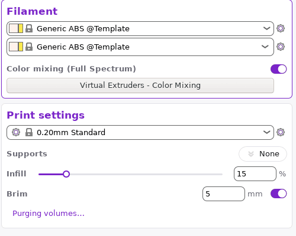
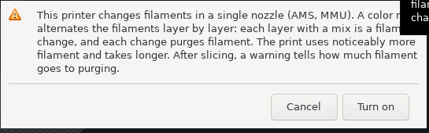
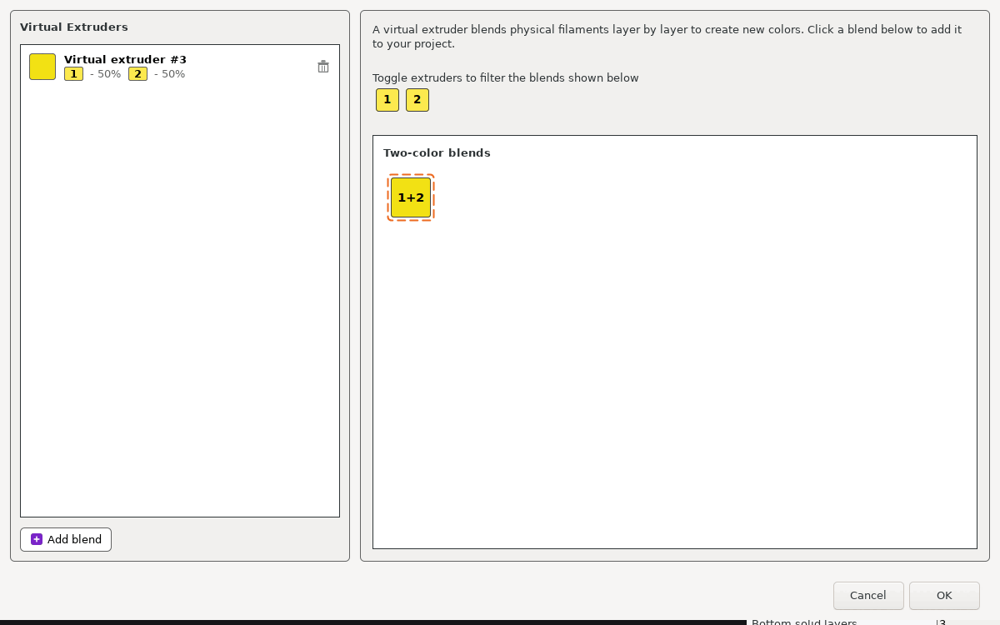
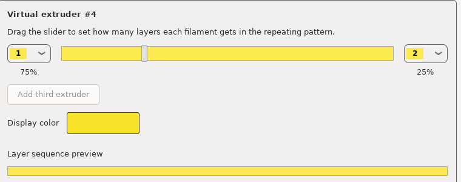

# Mezcla de colores en una sola boquilla (Full Spectrum)

**Qué hace:** con dos o más filamentos, la persona crea colores nuevos: una mezcla alterna los filamentos capa por
capa, y a la distancia el ojo ve el color intermedio. Esta ficha dice qué pone la persona y qué hace el G-code. Las
reglas de la interfaz (cuándo se ofrece, el aviso de costo) están en `multimaterial.md`; el cambio de filamento y la
torre de purga, en `multi_extruder.md`.

**Fase:** después de la primera versión, con `multimaterial.md`.

**Fuentes:**
- Prusa Research, [«Print with dozens of colors: Our new open-source ColorMix»](https://blog.prusa3d.com/our-new-open-source-colormix-model-in-prusaslicer-and-easyprint_136079/):
  la idea (capas alternadas, proporciones por bloques de capas);
- las mediciones de abajo, hechas el 24-10-2026 en Tisma Slicer como caja negra: proyectos con mezclas laminados desde
  la línea de comandos, y la interfaz bajo Xvfb.

## Datos del proyecto

Las mezclas son del proyecto, no de un perfil: viajan con la pieza.

| Dato | Unidad | Qué es |
|---|---|---|
| Número de la mezcla | entero | El siguiente a los filamentos reales: con 2 filamentos, la primera mezcla es la 3 |
| Componentes | filamento y parte (0 a 1) | Hasta 3 filamentos; las partes suman 1 |
| Color para mostrar | color | El color previsto de la mezcla, para la vista 3D y la lista |
| Degradé (opcional) | Z mín. y máx. en mm, puntos (filamento, posición 0 a 1) | En lugar de partes fijas, la mezcla cambia con la altura |

Una pieza o una parte que usa el número de la mezcla se imprime con ella, igual que con un filamento (prueba FS1).

## Lo que pone la persona

1. **La opción:** en una impresora de una sola boquilla con dos o más filamentos, la tarjeta Filament muestra «Color
   mixing (Full Spectrum)», apagada. Al prenderla aparece el aviso de costo (`multimaterial.md`, regla 9) con
   «Cancel» y «Turn on»; con la opción prendida aparece el botón «Virtual Extruders - Color Mixing».

| Opción prendida | Aviso |
|---|---|
|  |  |

2. **El diálogo:**
   - a la izquierda, la lista de mezclas del proyecto: «Virtual extruder #3» con el color previsto y la parte de cada
     filamento («1 - 50 %, 2 - 50 %»), un tacho para borrarla y el botón «Add blend»;
   - a la derecha: «A virtual extruder blends physical filaments layer by layer to create new colors. Click a blend
     below to add it to your project.», los filamentos como chips para filtrar, y «Two-color blends» con los pares
     de filamentos («1+2» con dos). Un clic en un cuadro agrega esa mezcla al 50 %;
   - «Cancel» y «OK».



3. **El editor de una mezcla** («Add blend» o elegir una de la lista): «Drag the slider to set how many layers each
   filament gets in the repeating pattern.»
   - un filamento a cada lado, elegido de una lista, y un deslizador entre los dos; debajo, la parte de cada uno en %;
   - «Add third extruder» (apagado con dos filamentos);
   - «Display color» y «Layer sequence preview», una franja con la secuencia de capas.



4. **Degradés:** el laminado y el archivo del proyecto los tienen (reglas 10 y 13), pero la interfaz no muestra el
   botón para crearlos.
5. **Menos filamentos:** al abrir un proyecto en una impresora con menos filamentos, se descartan las mezclas que usan
   filamentos que no hay, y no vuelven al agregar los filamentos (prueba FS12).

## Reglas del G-code

6. **Una capa, un filamento:** la zona mezclada no tiene movimientos especiales. Cada capa se imprime entera (paredes,
   relleno, superficies) con el filamento que le toca a esa capa en la mezcla.
7. **El ciclo:** la parte de cada filamento se convierte en un ciclo de capas que se repite:
   - es el ciclo más corto, de 2 a 64 capas, en el que la parte de cada filamento queda a 3 puntos o menos de la pedida;
   - cada filamento tiene al menos una capa por ciclo;
   - después se simplifica (2 y 2 capas pasan a 1 y 1).

| Pedido (filamento 1 : 2) | Ciclo | Filamento 1 en el ciclo |
|---|---|---|
| 50 : 50 | 2 capas | 1 (50 %) |
| 45 : 55 | 7 | 3 (42,9 %) |
| 40 : 60 | 5 | 2 (40 %) |
| 35 : 65 | 3 | 1 (33,3 %) |
| 30 : 70 | 7 | 2 (28,6 %) |
| 25 : 75 | 4 | 1 (25 %) |
| 20 : 80 | 5 | 1 (20 %) |
| 15 : 85 | 6 | 1 (16,7 %) |
| 10 : 90 | 8 | 1 (12,5 %) |
| 7 : 93 | 11 | 1 (9,1 %) |
| 5 : 95 | 13 | 1 (7,7 %) |

8. **Orden dentro del ciclo:** los filamentos se reparten lo más parejo posible. En cada capa va el filamento que más
   atrasado está respecto de su parte hasta esa capa; si dos están igual, el que está primero en la mezcla. Por
   ejemplo, 25 : 75 da 2, 1, 2, 2 y 40 : 60 da 2, 1, 2, 1, 2 (pruebas FS2 a FS5).
9. **Dónde empieza:** el ciclo se cuenta desde la primera capa del objeto y se repite hasta arriba.
10. **Degradé:**
    - el rango es el de la mezcla (Z mín. y máx.) o, si no tiene, cada tramo seguido de capas donde la mezcla aparece;
    - se divide en bandas: una cada 10 capas del rango, al menos 2 y como mucho 11 (FS9 mide 5 bandas en 50 capas);
    - cada banda usa la proporción del punto medio de la banda, interpolada entre los puntos y redondeada a pasos de
      10 %, con su propio ciclo (reglas 7 y 8) que empieza en la primera capa de la banda;
    - debajo del primer punto va todo el primer filamento; encima del último, todo el último (prueba FS9).
11. **Cambios de filamento en una capa con varias zonas:** la capa empieza con el filamento que dejó la anterior, para
    cambiar lo menos posible (prueba FS10).
12. **Costo en una sola boquilla:** cada capa que cambia de filamento hace un cambio con su purga en la torre
    (`multi_extruder.md`). Con una mezcla 50 : 50, casi todo el filamento va a la purga (prueba FS11). Con una boquilla
    por filamento, la torre es mucho más chica.
13. **Plantillas:** cada cambio usa la plantilla de cambio de herramienta del perfil. Un perfil que trae una plantilla
    con variables que el programa no conoce hace fallar la exportación recién al usar la primera mezcla (prueba FS13).
    El motor debe avisarlo al prender la mezcla, no al exportar.

## Archivo del proyecto

14. **Dónde:** en el 3MF, en `Metadata/Prusa_Slicer_full_spectrum.json`. La pieza o la parte guarda el número de la
    mezcla como su extrusor (el número 3 en el ejemplo). Tisma Slicer lo escribe al guardar desde la interfaz; desde
    la línea de comandos no lo escribe (prueba FS14). El motor lo escribe siempre que haya mezclas.
15. **Contenido** (lo que guardó Tisma Slicer con dos mezclas):

```json
{
  "version": 1,
  "physical_extruders": [{"id": 1, "color": "#FCE94F"}, {"id": 2, "color": "#FCE94F"}],
  "virtual_extruders": [
    {"id": 3, "kind": "fullspectrum", "color": "#f3e115",
     "components": [{"extruder": 1, "ratio": 0.5}, {"extruder": 2, "ratio": 0.5}]},
    {"id": 4, "kind": "fullspectrum", "color": "#f6e329",
     "components": [{"extruder": 1, "ratio": 0.75}, {"extruder": 2, "ratio": 0.25}]}
  ]
}
```

16. **Degradé en el archivo:** `"kind": "gradient"`, `minz` y `maxz` en mm (opcionales) y componentes con `extruder`
    y `position` de 0 a 1 en lugar de `ratio`. Al leer, se aceptan partes que no suman 1: 1 y 3 equivale a 0,25 y 0,75
    (prueba FS2).

## Pruebas

Medidas en Tisma Slicer (24-10-2026) con los ajustes base de `walls_extra.md` (boquilla 0,4, capas de 0,2, 2
perímetros, sin relleno, sin falda ni borde), una impresora de una boquilla con 2 o 3 filamentos, torre de purga y E
relativa. **Caja:** 20 × 20 × 10 mm, 50 capas, con el número de la mezcla. En las secuencias, cada cifra es el
filamento de una capa, desde la primera.

| # | Escenario | Resultado |
|---|---|---|
| FS1 | Caja con la mezcla 3 = 1 : 1 | Capas 1, 2, 1, 2…; 49 cambios en 50 capas |
| FS2 | Mezcla 1 : 3, y la misma como 0,25 : 0,75 | Igual en los dos casos: 2, 1, 2, 2 repetido; 25 cambios |
| FS3 | Mezcla 2 : 3 | 2, 1, 2, 1, 2 repetido |
| FS4 | Mezcla 3 : 7 | 2, 1, 2, 2, 2, 1, 2 repetido (ciclo de 7, no de 10) |
| FS5 | Mezclas 1 : 9, 0,07 : 0,93 y 0,05 : 0,95 | Un 1 cada 8, cada 11 y cada 13 capas; el primero en la capa 4, 6 y 7 |
| FS6 | Mezclas 0,15, 0,2, 0,35 y 0,45 del filamento 1 | Ciclos de 6, 5, 3 y 7 capas (tabla de la regla 7) |
| FS7 | Tres filamentos, mezcla 4 = 1 : 1 : 1 | 1, 2, 3 repetido; 49 cambios |
| FS8 | Mezcla con un componente en 0 | Todo con el otro filamento, sin cambios |
| FS9 | Degradé del filamento 1 al 2 entre Z 0 y 10 mm | 5 bandas de 10 capas; el filamento 2 está en 1, 3, 6, 7 y 9 capas de cada tramo de 2 mm. Secuencia: `11112111111211121121212121212212221221222212222222` |
| FS10 | Mitad de la caja con el filamento 1 y mitad con la mezcla 1 : 1 | En las capas 1.ª, 3.ª, 5.ª…, todo con el 1; en la 2.ª, 4.ª…, primero la mitad del 1 y después la mezcla con el 2. 49 cambios |
| FS11 | Costo de la caja de FS1, densidad 1,24 | Una boquilla: 1912,84 y 1840,58 mm de filamento, 11,19 g en total y 10,17 g en la torre; 55 min. La caja sola con un filamento: 171,55 mm y 4 min 29 s. Con una boquilla por filamento: 449,23 y 426,99 mm, 14 min 33 s |
| FS12 | Abrir un proyecto con la mezcla 3 en una impresora de un filamento, después pasarla a dos | El diálogo de mezclas está vacío |
| FS13 | Perfil cuya plantilla de cambio usa una variable desconocida, laminar con una mezcla | «G-code export … failed due to invalid custom G-code», la plantilla y «Parsing error at line 2: Not a variable name» con una marca |
| FS14 | Guardar el proyecto desde la interfaz y exportarlo desde la línea de comandos | Desde la interfaz, el archivo de la regla 15; desde la línea de comandos, el 3MF sin ese archivo (la parte conserva el extrusor 3) |
