# Página de dispositivos y conexiones por marca

**Qué hace:** la página Printer > Devices junta las impresoras que la persona tiene: la que está enchufada por USB y
las de la red local. Para cada una muestra su estado y su cámara, y desde ahí se manda la placa laminada. Cada
impresora de red se guarda con su tipo de conexión, su dirección y su clave.

Esta ficha describe las pantallas y cada tipo de conexión, medidos en Tisma Slicer. Las reglas de bajo nivel (USB,
Bambu Lab, cámara USB, botón principal) están en `printer_connections.md`.

**Fase:** F9, junto con `printer_connections.md`; las pantallas son parte de P1 (`interface.md`).

**Fuentes:**
- las mediciones de abajo, hechas el 24-10-2026 en Tisma Slicer como caja negra, bajo Xvfb, contra simuladores propios
  de cada impresora (programas que contestan como ella);
- la documentación oficial de cada API, en la tabla «Tipos de conexión». Donde dice «ninguna oficial», el fabricante
  no publica la API y solo hay documentación de la comunidad.

## Ajustes de una impresora de red

Se guardan en la computadora, no en el proyecto: son de la persona, no de la pieza.

| Clave | Unidad | Por defecto | Qué hace |
|---|---|---|---|
| `device.name` | texto | vacío | Nombre que ve la persona; la lista de impresoras lo muestra como «Nombre (perfil)» |
| `device.profile` | perfil | el elegido | Perfil de impresora con el que se lamina para ella (`profiles.md`) |
| `device.connection` | lista | OctoPrint | Tipo de conexión (tabla «Tipos de conexión») |
| `device.address` | texto | vacío | IP, nombre o URL; puede llevar el puerto (`192.168.1.20:7125`) |
| `device.secret` | texto | vacío | Clave de API, contraseña o código de acceso, según el tipo; es un secreto |
| `device.ca_file` | ruta | vacía | Certificado de una autoridad propia, para HTTPS con certificado autofirmado |
| `device.serial` | texto | vacío | Número de serie (solo Flashforge) |
| `device.use_ams` | — | no | Imprimir tomando el filamento del AMS (solo Bambu Lab) |
| `device.repetier_printer` | texto | vacío | Cuál de las impresoras del servidor Repetier (solo Repetier) |
| `device.start_print` | — | sí | Después de subir, empezar la impresión (interruptor «Start printing» de la página) |
| `device.camera` | lista | la de la impresora, si tiene | «The camera of the printer», «No camera» o una cámara USB (`printer_connections.md`) |

## Pantallas

### La página

1. **Dónde está:** Printer, chip «Devices» arriba a la izquierda (al lado de «Settings»). El chip de la impresora en la
   barra de arriba (con un punto verde cuando su impresora de red contesta) también lleva acá.
2. **Columna izquierda:**
   - arriba, «USB printer (detected when connected)»; después, cada impresora de red como «Nombre — dirección»;
   - abajo, tres botones: «+ Add network printer», «Edit printer…» y «Change access code…». Los dos últimos se apagan
     con la impresora USB elegida.
   - el botón «+ Add network printer» explica en su ayuda: «Bambu Lab (LAN), Flashforge, OctoPrint, Klipper (Moonraker:
     Mainsail, Fluidd), PrusaLink, Duet, Repetier, MKS, FlashAir, AstroBox. The printers of the local network can be
     searched in the dialog.»
3. **Encabezado de la impresora elegida:** su nombre en violeta y, a la derecha, el interruptor «Start printing», el
   botón «Send sliced G-code» y el botón «Open in browser». Debajo, el selector «Camera».

### Impresora USB

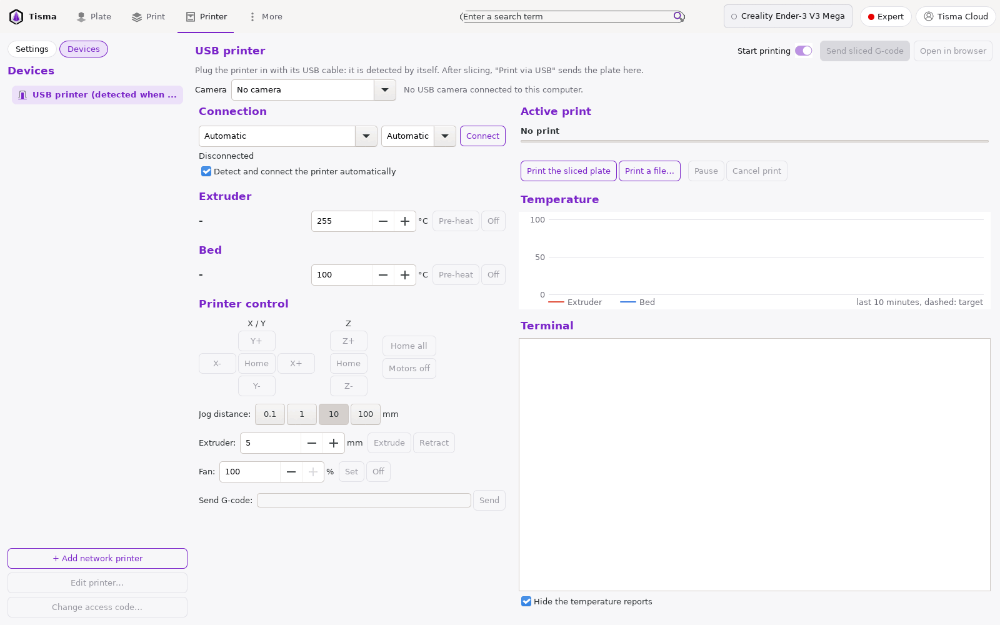

4. **Texto:** «Plug the printer in with its USB cable: it is detected by itself. After slicing, "Print via USB" sends
   the plate here.»
5. **A la izquierda:**
   - Connection: puerto y velocidad (los dos «Automatic» al empezar), «Connect», el estado («Disconnected») y la casilla
     «Detect and connect the printer automatically»;
   - Extruder y Bed: la temperatura actual, el objetivo con − y +, «Pre-heat» y «Off»;
   - Printer control: mover X/Y y Z, «Home», «Home all», «Motors off», distancia de 0,1, 1, 10 o 100 mm, extruir y
     retraer una longitud, ventilador en % con «Set» y «Off», y «Send G-code» con un campo.
6. **A la derecha:**
   - Active print: el archivo y una barra de avance; «Print the sliced plate», «Print a file…», «Pause» y «Cancel
     print»;
   - Temperature: gráfico de los últimos 10 minutos, boquilla y cama; la línea punteada es el objetivo;
   - Terminal: lo que se manda y lo que contesta la impresora, con la casilla «Hide the temperature reports».
7. **Sin impresora conectada,** los botones de control están apagados. «Send sliced G-code» y «Open in browser» están
   apagados en la impresora USB.

### Agregar o editar una impresora de red

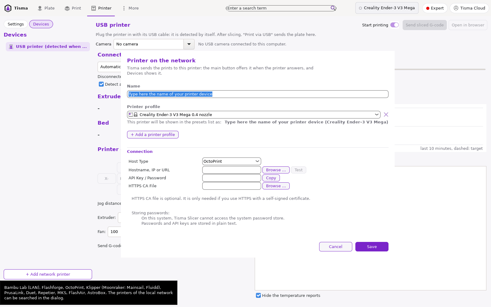

8. **Diálogo «Printer on the network»:** «Tisma sends the prints to this printer: the main button offers it when the
   printer answers, and Devices shows it.»
   - **Name:** empieza con el texto «Type here the name of your printer device» seleccionado;
   - **Printer profile:** el perfil, una × para quitarlo y «+ Add a printer profile» para elegir varios. Debajo dice
     cómo va a aparecer: «This printer will be shown in the presets list as: Nombre (perfil)»;
   - **Connection:** «Host Type», «Hostname, IP or URL» (con «Browse…» y «Test»), «API Key / Password» (con «Copy»),
     «HTTPS CA File» (con «Browse…») y los campos propios del tipo;
   - debajo, notas: «HTTPS CA file is optional. It is only needed if you use HTTPS with a self-signed certificate.» y,
     cuando el sistema no tiene un almacén de contraseñas, «Passwords and API keys are stored in plain text.»;
   - al final, una ayuda propia del tipo (Bambu Lab y Flashforge) y «Cancel» y «Save».
9. **«Edit printer…»** abre el mismo diálogo con los datos guardados.

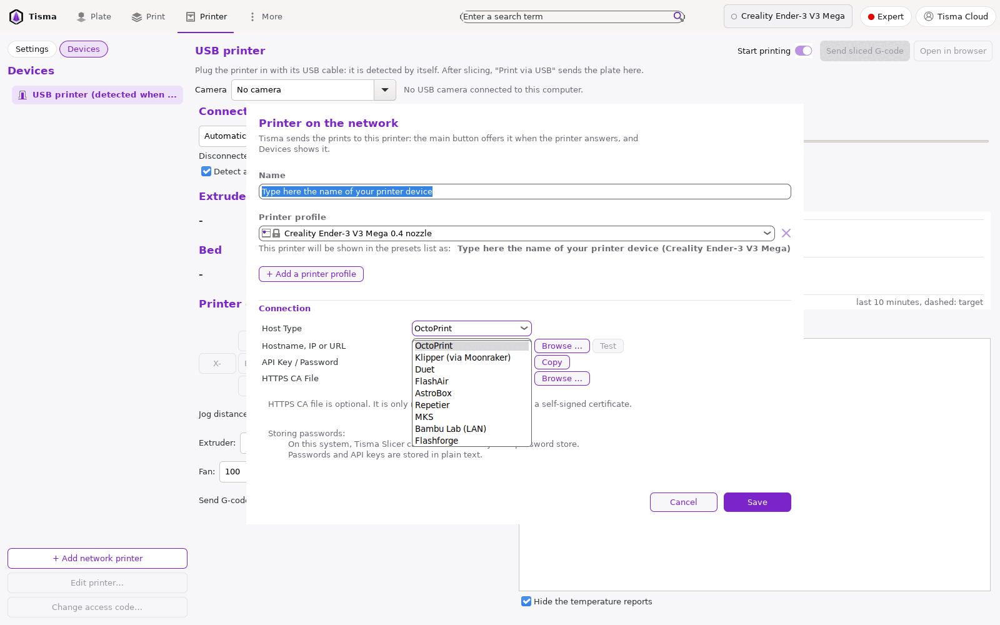

10. **Diferencias por tipo en el diálogo:**

| Tipo | «Browse…» (buscar en la red) | Campos de más | Ayuda propia |
|---|---|---|---|
| OctoPrint, Klipper (via Moonraker), AstroBox | sí | — | — |
| Repetier | sí | «Printer» con «Refresh Printers» | — |
| Duet, FlashAir, MKS | apagado | — | — |
| Bambu Lab (LAN) | no aparece | «Print from the AMS» | ver regla 11 |
| Flashforge | sí | «Serial number» | ver regla 12 |

11. **Ayuda de Bambu Lab:** «Bambu Lab: on the printer turn on LAN only mode and Developer mode (Settings > LAN only).
    Hostname = IP address of the printer, API key = access code shown there. The serial number is read from the
    printer.»
12. **Ayuda de Flashforge:** «Flashforge: Browse finds the printers of the network. Adventurer 5M, 5M Pro and AD5X:
    turn on LAN mode on the printer (Settings > Network); API key = its access code, and the serial number. Older
    printers need only the IP address.»
13. **PrusaLink y Prusa Connect** no aparecían en la lista con un perfil que no es de Prusa (prueba D23).

### Probar la conexión

| Funciona | Sin respuesta |
|---|---|
| 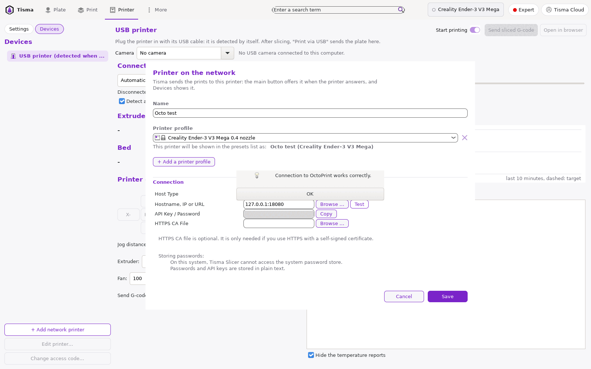 | 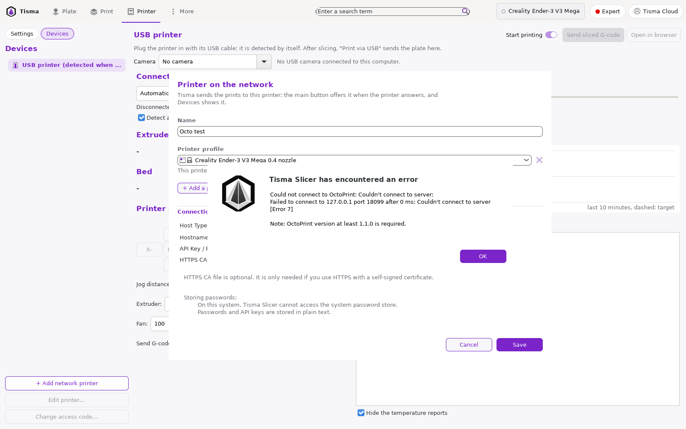 |

14. **«Test»** prueba la dirección y la clave sin guardar. Contesta en un mensaje: «Connection to OctoPrint works
    correctly.» o «Could not connect to OctoPrint: » con la causa, el código de error y una nota del tipo (por ejemplo
    «Note: OctoPrint version at least 1.1.0 is required.»). Los textos de cada tipo están en las pruebas.

### Impresora de red

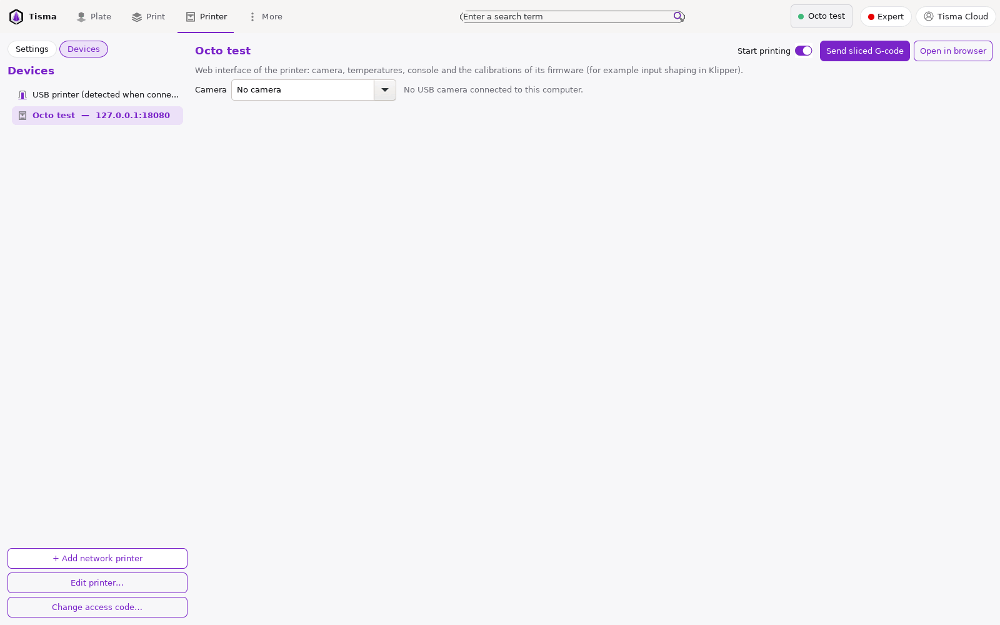

15. **Interfaces web** (OctoPrint, Moonraker, PrusaLink, Duet, AstroBox, Repetier): «Web interface of the printer:
    camera, temperatures, console and the calibrations of its firmware (for example input shaping in Klipper)».
    «Open in browser» abre esa interfaz. La cámara empieza en «No camera».
16. **Bambu Lab:** al elegirla se lee su estado y se muestra en una línea, con «Select it again to refresh.» debajo; la
    cámara empieza en «The camera of the printer» y se ve abajo. «Open in browser» queda apagado.

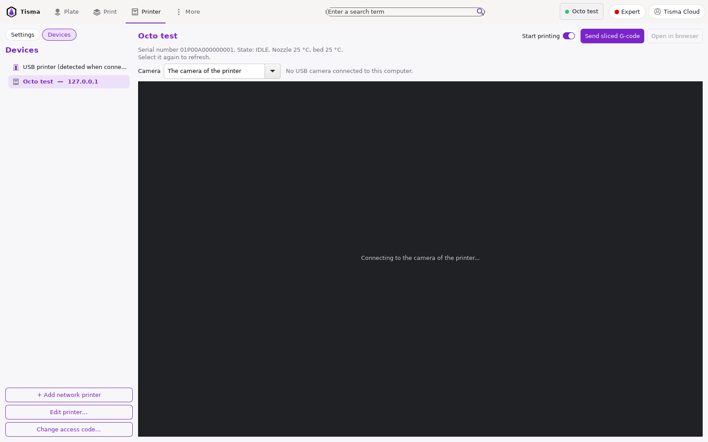

17. **Flashforge:** al elegirla se prueba la conexión y se muestra el resultado, con «Select it again to test again. If
    the access code changed, use "Change access code".» La cámara empieza en «No camera».

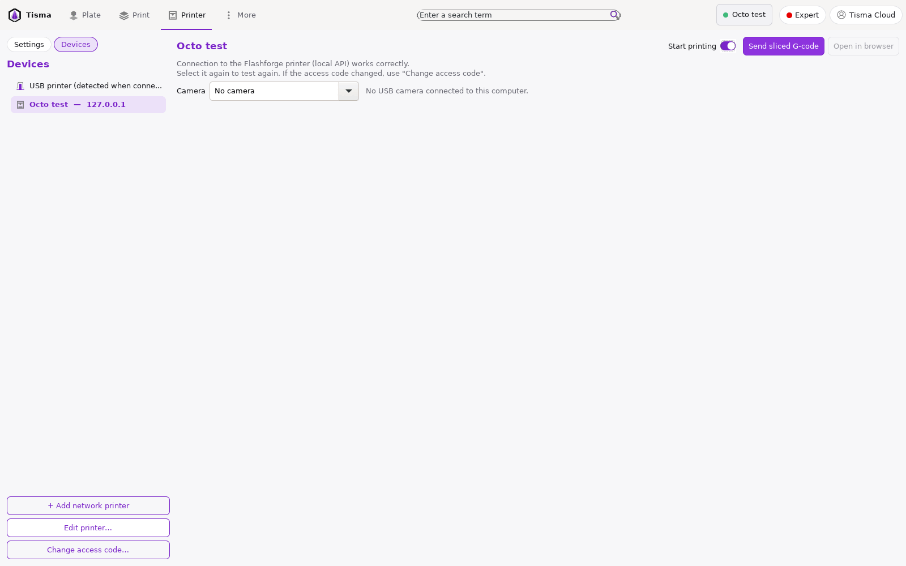

### Cambiar el código de acceso

18. **«Change access code…»** pide «New access code or API key of the printer:» con el valor de ahora. En Bambu Lab, el
    código nuevo se prueba antes de guardarlo:
    - si sirve, se guarda sin preguntar y la línea de estado se actualiza;
    - si la impresora lo rechaza, avisa y pregunta «Save the new code anyway?»; con «No» queda el de antes.

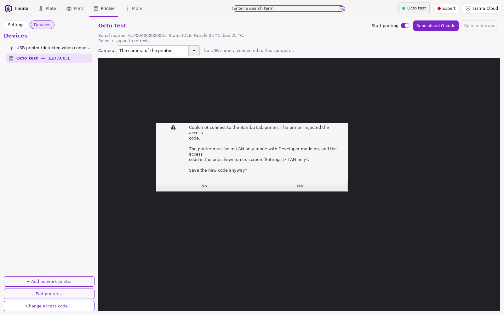

### Enviar

19. **Botón principal:** después de laminar, si la impresora de red contesta, el botón pasa a «Send to printer» con
    una flecha ▲ para las otras salidas (`printer_connections.md`).
20. **Diálogo de envío:** «Upload to Printer Host with the following filename:», el nombre editable (el del formato de
    nombre de archivo, `gcode_templates.md`; por ejemplo `cube20_ABS_18m.gcode`) y «Use forward slashes ( / ) as a
    directory separator if needed.» Botones «Upload», «Upload and Print» y «Cancel»; con Duet, también «Upload and
    Simulate».
21. **Aviso:** abajo en la vista aparece «archivo → dirección» con el estado: «RESOLVING ADDRESS», después «UPLOADED» o
    «ERROR». Si falla, además un mensaje con la causa.

| Botón | Diálogo | Subido |
|---|---|---|
| 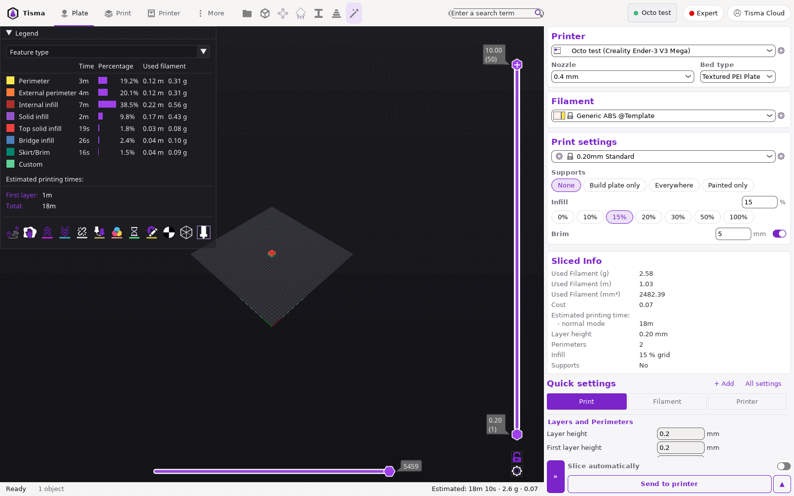 | 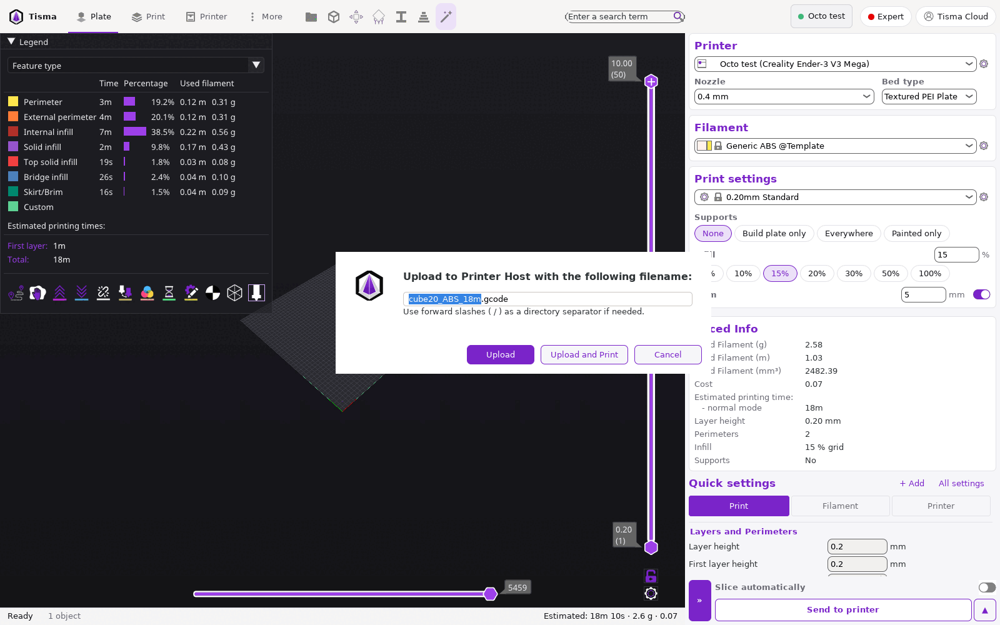 | 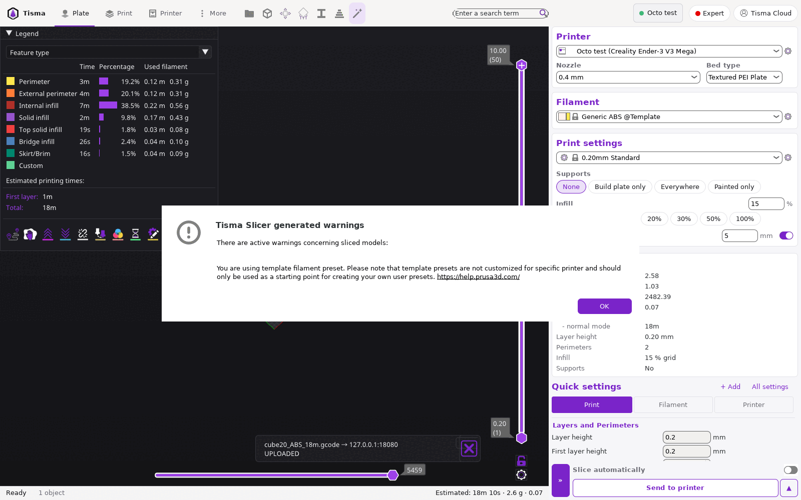 |

22. **Desde Devices,** «Send sliced G-code» manda la placa sin diálogo, con el nombre de la placa, a la impresora
    elegida: sube e imprime si «Start printing» está prendido, y solo sube si está apagado (pruebas D11 y D12).
23. **Sin nada laminado,** el envío no sale: «Slice the plate first: there is no sliced G-code to send.»

## Tipos de conexión

| Tipo | Qué pide | Probar | Subir | Imprimir | Estado en Devices | Documentación oficial |
|---|---|---|---|---|---|---|
| USB | nada (se detecta) | conectar | por líneas | sí | temperaturas, avance, terminal | [G-code de RepRap](https://reprap.org/wiki/G-code), [Marlin](https://marlinfw.org/meta/gcode/) |
| OctoPrint | dirección, clave de API | sí | sí | sí | interfaz web | [REST API](https://docs.octoprint.org/en/master/api/index.html), [archivos](https://docs.octoprint.org/en/master/api/files.html) |
| Klipper (via Moonraker) | dirección (con su puerto), clave si la pide | sí | sí | sí | interfaz web | [Moonraker](https://moonraker.readthedocs.io/en/latest/external_api/introduction/), [archivos](https://moonraker.readthedocs.io/en/latest/external_api/file_manager/) |
| PrusaLink | dirección, clave o usuario y contraseña | sí | sí | sí | interfaz web | [OpenAPI de PrusaLink](https://github.com/prusa3d/Prusa-Link-Web/blob/master/spec/openapi.yaml) |
| Prusa Connect | cuenta de Prusa | no se midió | no se midió | no se midió | no se midió | ninguna oficial para imprimir; solo la [API de cámaras](https://help.prusa3d.com/article/prusa-connect-camera-api_569012) |
| Duet (RepRapFirmware) | dirección, contraseña de la placa | sí | sí | sí, y simular | interfaz web | [pedidos HTTP de RepRapFirmware](https://github.com/Duet3D/RepRapFirmware/wiki/HTTP-requests) |
| FlashAir (tarjeta SD con Wi-Fi) | dirección | sí | no se midió | no se midió | no se midió | el sitio oficial (FlashAir Developers) ya no contesta |
| AstroBox | dirección, clave de API | sí | sí | sí | interfaz web | ninguna oficial encontrada (es una derivación de OctoPrint) |
| Repetier-Server | dirección, clave de API, impresora del servidor | sí | sí | sí | interfaz web | [Web API de Repetier-Server](https://www.repetier-server.com/manuals/programming/API/index.html) |
| MKS (módulo Wi-Fi de Makerbase) | dirección | sí | no se midió | no se midió | no se midió | ninguna oficial encontrada |
| Bambu Lab (LAN) | IP, código de acceso; AMS sí o no | sí (y al elegirla) | FTPS | MQTT | estado, temperaturas, cámara | solo cómo [activar el modo desarrollador](https://wiki.bambulab.com/en/knowledge-sharing/enable-developer-mode); el protocolo, [OpenBambuAPI](https://github.com/Doridian/OpenBambuAPI) (comunidad) |
| Flashforge | IP; en las nuevas, número de serie y código | sí (y al elegirla) | sí | sí | resultado de la prueba | ninguna oficial encontrada; la comunidad, [ff-5mp-api-py](https://github.com/GhostTypes/ff-5mp-api-py) |

24. **Pedidos medidos** contra los simuladores, en el orden en que llegan. Antes de subir, cada interfaz web recibe
    `GET /` para saber si contesta. «—»: no se midió.

| Tipo | Probar | Subir e imprimir |
|---|---|---|
| OctoPrint | `GET /api/version` con la clave en `X-Api-Key` | `POST /api/files/local` (multipart, con el archivo y la orden de imprimir) |
| Moonraker | `GET /server/info` | `POST /server/files/upload` (multipart, con la orden de imprimir) |
| PrusaLink | — | `GET /api/v1/storage`, `GET /api/version`, `POST /api/files/local` |
| Duet | — | `GET /rr_connect?password=…&time=…`, `POST /rr_upload?name=0:/gcodes/<nombre>&time=…`; imprimir `GET /rr_gcode?gcode=M32 "0:/gcodes/<nombre>"`, simular `M37 P"0:/gcodes/<nombre>"`; al final `GET /rr_disconnect` |
| AstroBox | — | `GET /api/version`, `POST /api/files/local` |
| Repetier | — | `POST /printer/api/<impresora>`, `GET /printer/info`, `POST /printer/job/<impresora>` |
| Bambu Lab | MQTT con TLS al 8883 (`printer_connections.md`) | FTPS al 990 y el comando `project_file` por MQTT (prueba D9) |
| Flashforge | API local al 8898 con número de serie y código; sin número de serie, la consola G-code (TCP 8899 en el simulador) | el archivo `.gcode` y la orden de imprimir (prueba D18) |

## Por marca

Tisma Slicer no tiene un tipo por marca: tiene un tipo por forma de conectarse. Para cada marca que se preguntó:

| Marca | Cómo se conecta en Tisma Slicer | Documentación oficial de la marca |
|---|---|---|
| Bambu Lab | «Bambu Lab (LAN)», en modo solo LAN y desarrollador; la nube de Bambu no | solo la página para activar el modo desarrollador; la marca no da soporte a ese protocolo |
| Prusa | PrusaLink en la red local; Prusa Connect por la nube (no medido); USB | OpenAPI de PrusaLink; de Prusa Connect, solo la API de cámaras |
| Creality | no hay tipo propio: las que corren Klipper con Moonraker, como «Klipper (via Moonraker)»; las demás, por USB | ninguna encontrada |
| Elegoo | no hay tipo propio: las que corren Klipper con Moonraker, como Moonraker; las demás, por USB. Las que hablan SDCP (por ejemplo la Centauri Carbon) no se pueden conectar | ninguna oficial encontrada para SDCP; hay documentación de la comunidad |
| Anycubic | no hay tipo propio: por USB, o con OctoPrint en el medio | la marca dice que su modo LAN solo funciona con su propio programa |
| Flashforge | «Flashforge»: las Adventurer 5M, 5M Pro y AD5X por su API local; las viejas por la consola G-code | ninguna oficial encontrada |
| Voron, RatRig y otras con Klipper | «Klipper (via Moonraker)» | Moonraker |
| Placas Duet | «Duet» | RepRapFirmware |
| Impresoras con Marlin (Ender y otras) | USB, o con OctoPrint en el medio | G-code de Marlin |
| Placas Makerbase con su módulo Wi-Fi | «MKS» | ninguna oficial encontrada |

## Reglas

25. **Secretos:** la clave, la contraseña y el código de acceso se guardan en el almacén de contraseñas del sistema.
    Si no hay, se guardan en texto y el diálogo lo avisa. Nunca se escriben en registros ni en mensajes de error.
26. **Mensajes de error:** dicen el tipo, la causa (con la dirección y el puerto que no contestaron) y qué revisar. Un
    error sin causa no se muestra: en Tisma Slicer, MKS dice «Could not connect to MKS: Success» (prueba D21); el motor
    tiene que nombrar la causa real.
27. **El código de acceso** de Bambu Lab y Flashforge se cambia desde «Change access code…» sin abrir el diálogo
    completo, porque la impresora lo cambia (por ejemplo al reiniciar el modo LAN).
28. **Buscar en la red** (Flashforge): manda un pedido de descubrimiento a toda la red local y, con una impresora que
    contesta, completa solos la dirección y el número de serie (prueba D17).
29. **Bambu Lab, paquete:** el archivo que se sube es `<nombre>.gcode.3mf`, un ZIP con:
    - `3D/3dmodel.model` (vacío), `[Content_Types].xml` y `_rels/.rels`;
    - `Metadata/plate_1.gcode` y `Metadata/plate_1.gcode.md5` (su MD5 en hexadecimal en mayúsculas);
    - `Metadata/slice_info.config` con el número de la placa (1).
30. **Bambu Lab, certificado:** con la autoridad que trae el programa, un certificado autofirmado (el del simulador) se
    rechaza: «Could not read the status of the printer: TLS: server certificate verification failed…». Con el
    certificado de esa autoridad en «HTTPS CA File» se conecta. El motor sigue `printer_connections.md` (huella
    confirmada por la persona).

## Pruebas

Medidas en Tisma Slicer (24-10-2026) bajo Xvfb, con la placa de un cubo de 20 mm laminada, contra simuladores que
contestan como cada impresora. Los códigos y claves usados son los de prueba de los simuladores; ninguno es de una
impresora real.

| # | Escenario | Resultado |
|---|---|---|
| D1 | OctoPrint, simulador en marcha, clave buena, «Test» | «Connection to OctoPrint works correctly.» |
| D2 | OctoPrint, nada escuchando en el puerto | «Could not connect to OctoPrint: Couldn't connect to server: Failed to connect to 127.0.0.1 port 18099 after 0 ms: Couldn't connect to server [Error 7] Note: OctoPrint version at least 1.1.0 is required.» |
| D3 | OctoPrint, «Upload and Print» | Llegan `GET /`, `GET /api/version`, `POST /api/files/local`; aviso «cube20_ABS_18m.gcode → 127.0.0.1:18080 UPLOADED» |
| D4 | Moonraker, PrusaLink, AstroBox y Repetier, «Upload and Print» | Los pedidos de la regla 24, en ese orden; aviso UPLOADED |
| D5 | Duet, «Upload and Simulate» | `rr_connect`, `rr_upload`, `rr_gcode` con `M37 P"0:/gcodes/cube20_ABS_18m.gcode"`, `rr_disconnect` |
| D6 | Bambu Lab, autoridad del programa, simulador con certificado autofirmado | Estado: «Could not read the status of the printer: TLS: server certificate verification failed…»; cámara: «Could not show the camera: …» |
| D7 | Bambu Lab, con el certificado del simulador en «HTTPS CA File» | «Serial number 01P00A000000001. State: IDLE. Nozzle 25 °C, bed 25 °C. Select it again to refresh.»; cámara «Connecting to the camera of the printer...» |
| D8 | Bambu Lab, «Change access code…» con un código distinto | «Could not connect to the Bambu Lab printer: The printer rejected the access code. The printer must be in LAN only mode with Developer mode on, and the access code is the one shown on its screen (Settings > LAN only). Save the new code anyway?» con «No» y «Yes». Con «No», el código guardado no cambia |
| D9 | Bambu Lab, «Send sliced G-code» con «Start printing» prendido | Sube `cube20_ABS_18m.gcode.3mf` (26 988 bytes, contenido de la regla 29) y manda `project_file` con `param` `Metadata/plate_1.gcode`, `url` `ftp://cube20_ABS_18m.gcode.3mf`, `subtask_name` igual al archivo, `bed_leveling` sí, `use_ams` no, `timelapse`, `flow_cali`, `vibration_cali` y `layer_inspect` no |
| D10 | Lo mismo con «Print from the AMS» prendido | Igual, con `use_ams` sí |
| D11 | Lo mismo con «Start printing» apagado | Sube el archivo y no manda ningún comando de impresión |
| D12 | Bambu Lab, código rechazado guardado con «Yes», elegirla otra vez | Estado: «Could not read the status of the printer: the printer rejected the access code»; cámara: «The printer closed the camera connection before sending an image: check the access code, and that the camera is on and not in use by another program.» |
| D13 | Bambu Lab, código rechazado, «Send to printer» > «Upload and Print» | «Error uploading to print host: The printer rejected the access code.»; aviso con «ERROR» |
| D14 | Flashforge, sin número de serie, «Test» | «Connection to the Flashforge printer (G-code console) works correctly.» |
| D15 | Flashforge, número de serie bueno y código equivocado | «Could not connect to the Flashforge printer: Serial number or check code error (1). Check the IP address, the serial number and the access code: turn on LAN mode on the printer (Settings > Network) to see the code.» |
| D16 | Flashforge, número de serie y código buenos | «Connection to the Flashforge printer (local API) works correctly.» |
| D17 | Flashforge, «Browse…» con la dirección y el número de serie vacíos | Se completan solos con los de la impresora que contestó |
| D18 | Flashforge, «Send sliced G-code» | La impresora recibe `cube20_ABS_18m.gcode` (145 500 bytes) y la orden de imprimirlo |
| D19 | Flashforge, dirección que no contesta | En Devices: «Could not connect to the Flashforge printer: Couldn't connect to server: Failed to connect to … port 8898 …», el consejo de D15 y «Select it again to test again. If the access code changed, use "Change access code".»; al enviar, «Error uploading to print host: …» |
| D20 | FlashAir, nada escuchando | «Could not connect to FlashAir: Couldn't connect to server: … [Error 7] Note: FlashAir with firmware 2.00.02 or newer and activated upload function is required.» |
| D21 | MKS, nada escuchando | «Could not connect to MKS: Success» (error sin causa; ver regla 26) |
| D22 | «Send sliced G-code» sin nada laminado | «Slice the plate first: there is no sliced G-code to send.» |
| D23 | Lista de tipos con un perfil de Creality | OctoPrint, Klipper (via Moonraker), Duet, FlashAir, AstroBox, Repetier, MKS, Bambu Lab (LAN), Flashforge; ni PrusaLink ni Prusa Connect |

### Capturas de los errores

| Código rechazado (D12) | Error al subir (D13) | Flashforge, código equivocado (D15) |
|---|---|---|
| 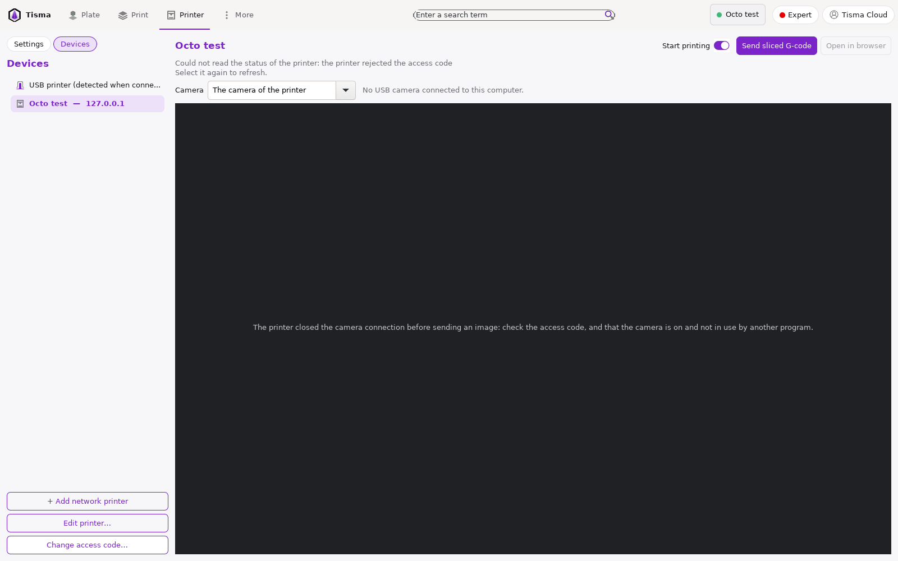 | 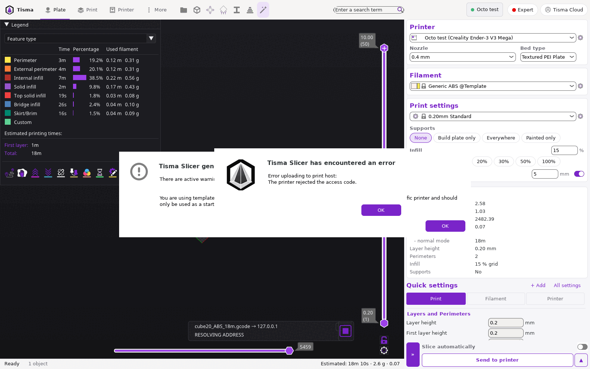 | 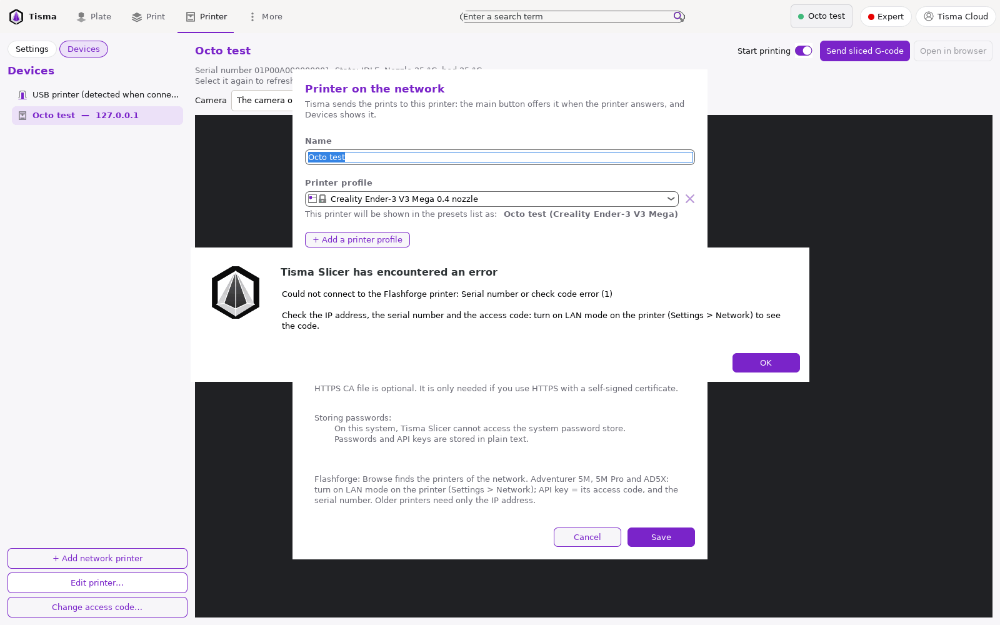 |

| Flashforge sin respuesta (D19) | FlashAir (D20) | MKS (D21) |
|---|---|---|
| 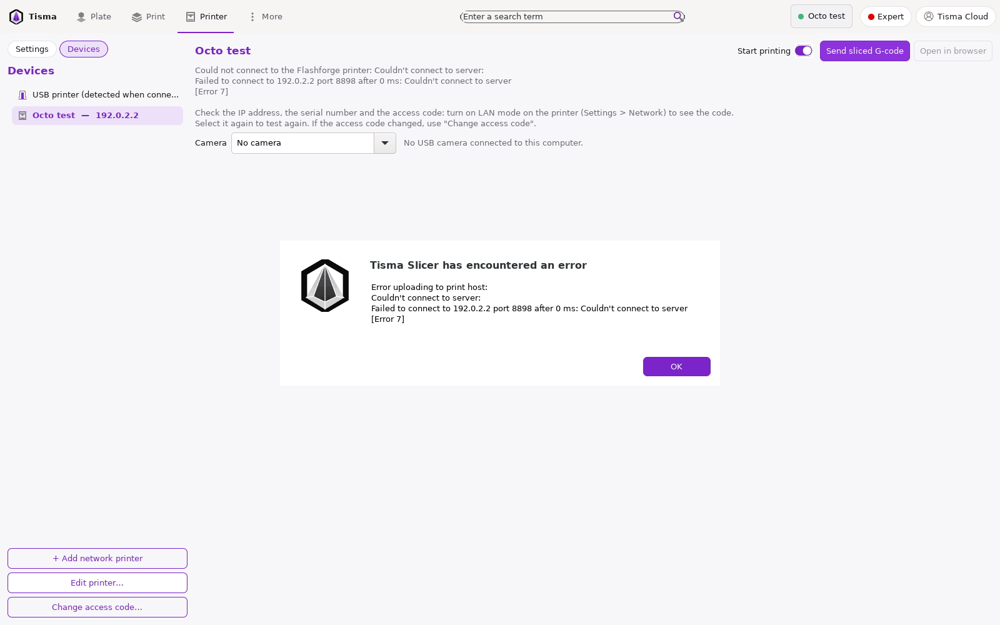 | 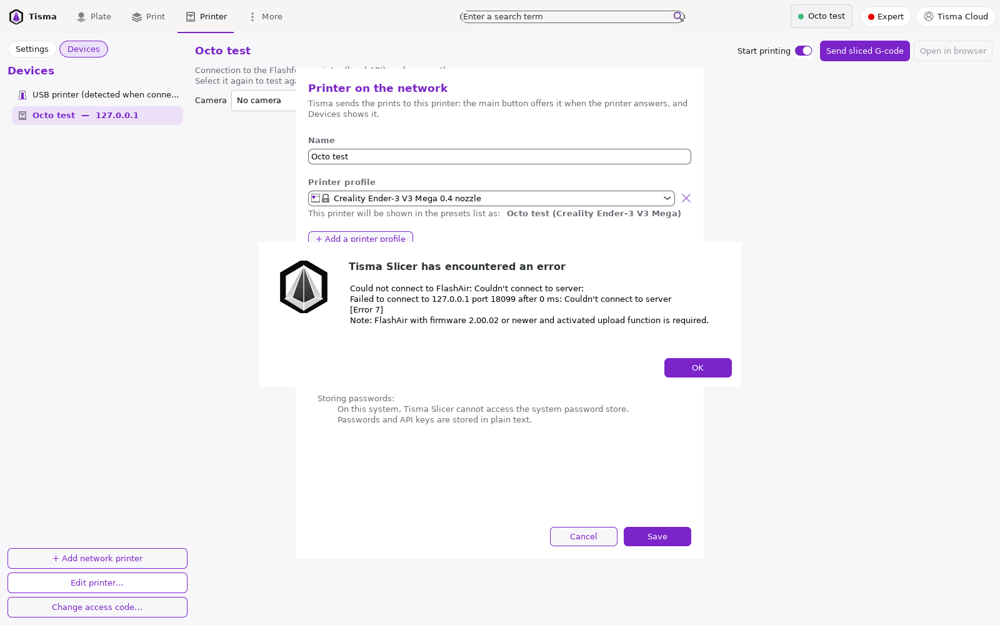 | 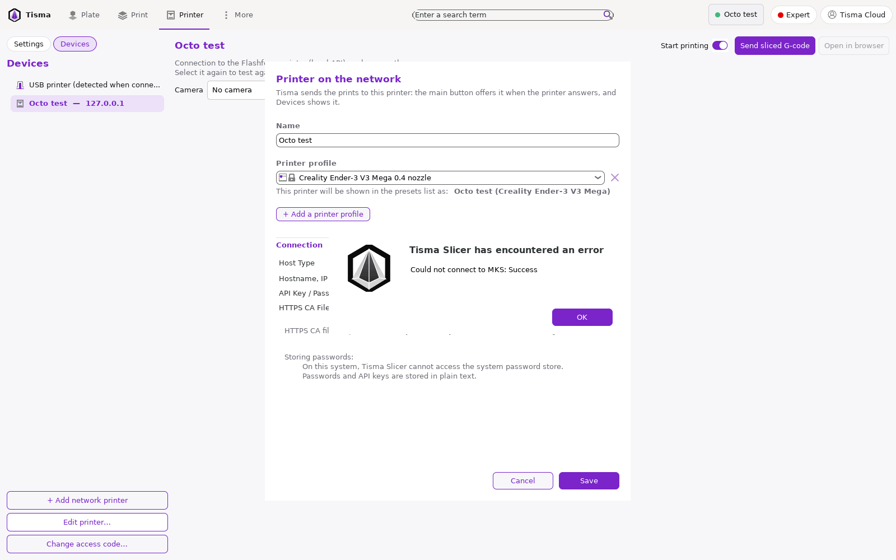 |

| Ajustes de Bambu Lab | Ajustes de Flashforge |
|---|---|
| 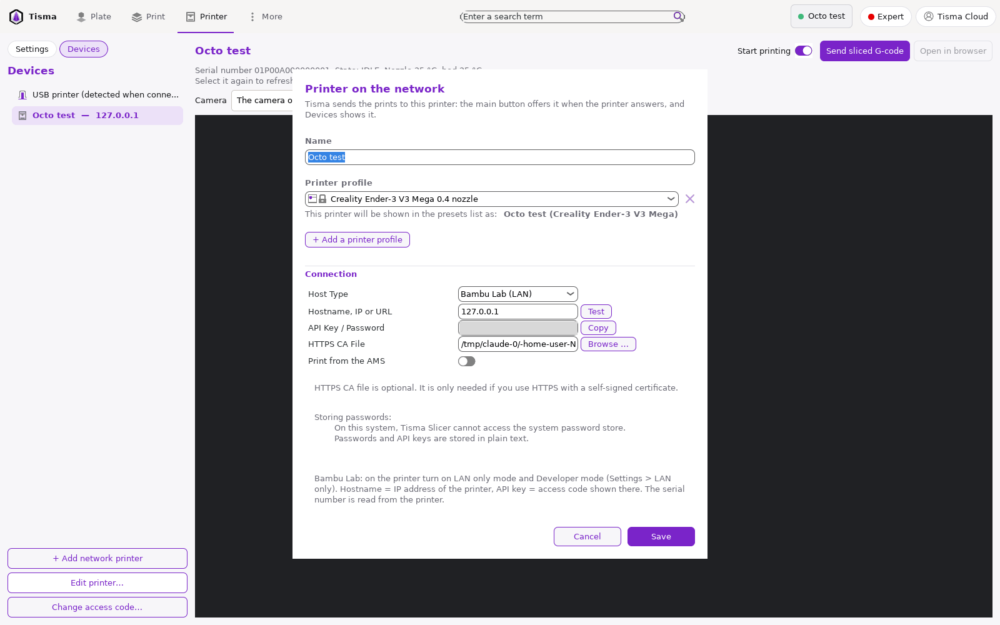 |  |

En las capturas, el campo de la clave está tapado aunque tenga una clave de prueba.

## Lo que falta medir

- Prusa Connect y PrusaLink con un perfil de Prusa (D23 solo muestra que no aparecen con otros perfiles).
- La impresora USB con un simulador conectado: temperaturas, terminal y avance (las reglas están en
  `printer_connections.md`, pruebas U1 a U5).
- La cola de envíos (Más > cola) y grabar el firmware de la impresora.
