# Perfiles del sistema y de la persona: guardar, heredar, comparar y respaldar

**Qué hace:** la persona parte de un perfil del sistema (impresora, material o impresión), lo cambia, lo guarda con su
nombre y lo sigue usando. Esta ficha dice cómo se comportan esos perfiles: herencia, cambios sin guardar, nombres,
compatibilidad, comparación, paquetes para llevarlos a otra computadora e instantáneas. Qué datos lleva cada perfil y de
dónde salen está en `profiles.md`; las impresoras físicas (una impresora con su conexión), en `devices.md`.

**Fase:** P3, con `profiles.md`.

**Fuentes:** mediciones del 24-10-2026 en Tisma Slicer como caja negra: la interfaz bajo Xvfb con una carpeta de
datos nueva (impresora Creality Ender-3 V3 Mega, boquilla 0,4), los archivos que quedan en esa carpeta y la línea de
comandos. Solo se toma el comportamiento; ningún valor de los perfiles de otros laminadores (`profiles.md`).

## Tipos de perfil

| Tipo | De dónde viene | Se puede cambiar | Se puede borrar |
|---|---|---|---|
| Del sistema | Lo instala el programa con la impresora (fabricante y versión) | No: un cambio se guarda como perfil nuevo | No |
| De la persona | Lo guarda la persona | Sí | Sí |
| Separado | De la persona, sin padre del sistema | Sí | Sí |

1. **Lista:** cada lista de perfiles (impresión, material, impresora) tiene dos grupos, «System presets» y «User
   presets». Los del sistema llevan un candado. Delante de cada perfil, una bandera verde si es compatible con la
   impresora elegida y roja si no.

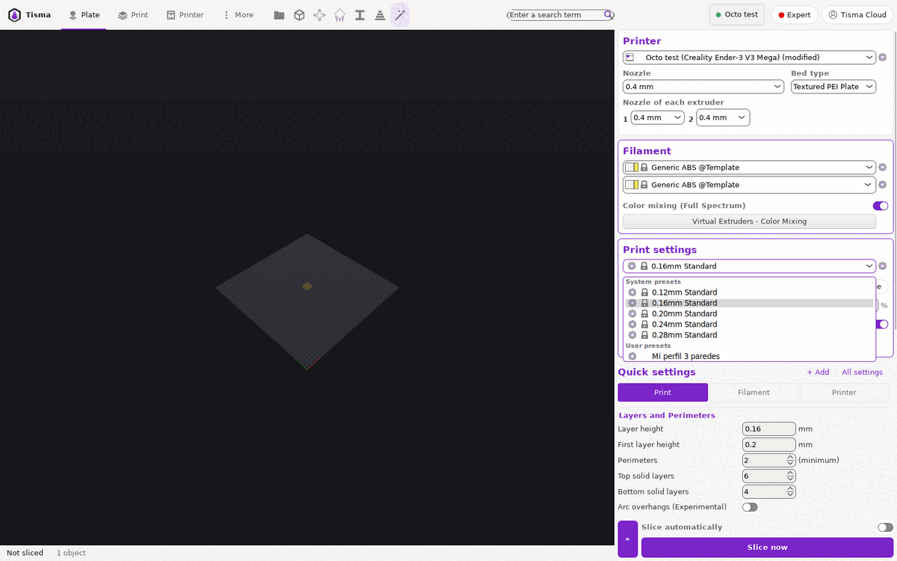

2. **Herencia:**
   - un perfil de la persona guarda el nombre de su padre del sistema y la lista completa de valores (no solo los que
     cambian);
   - en la página «Dependencies» se lee «Current preset is inherited from: <padre>» y los datos del padre
     («vendor: Creality (Creality Print), ver: 1.0.1»);
   - un perfil del sistema muestra en su lugar: «This is a system preset. It can't be deleted or modified. Any
     modifications should be saved as a new preset inherited from this one. To do that please specify a new name for
     the preset.», con su nombre completo y su nombre corto (sin la impresora).

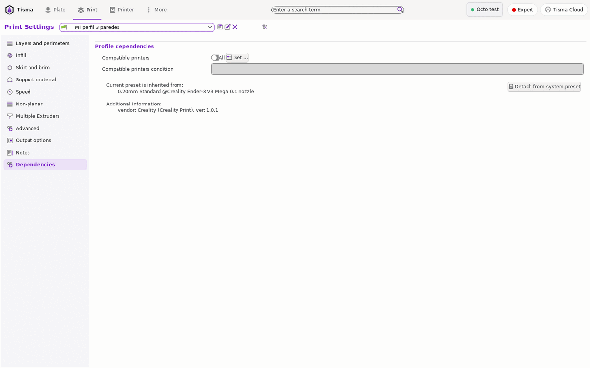

## Cambios sin guardar

3. **Marca:** al cambiar un valor, el nombre en la lista pasa a «<nombre> (modified)». Al lado de cada opción:
   - un candado abierto si el valor es distinto del padre del sistema (un clic vuelve al del padre);
   - una flecha hacia atrás si es distinto del último guardado (un clic vuelve al guardado).

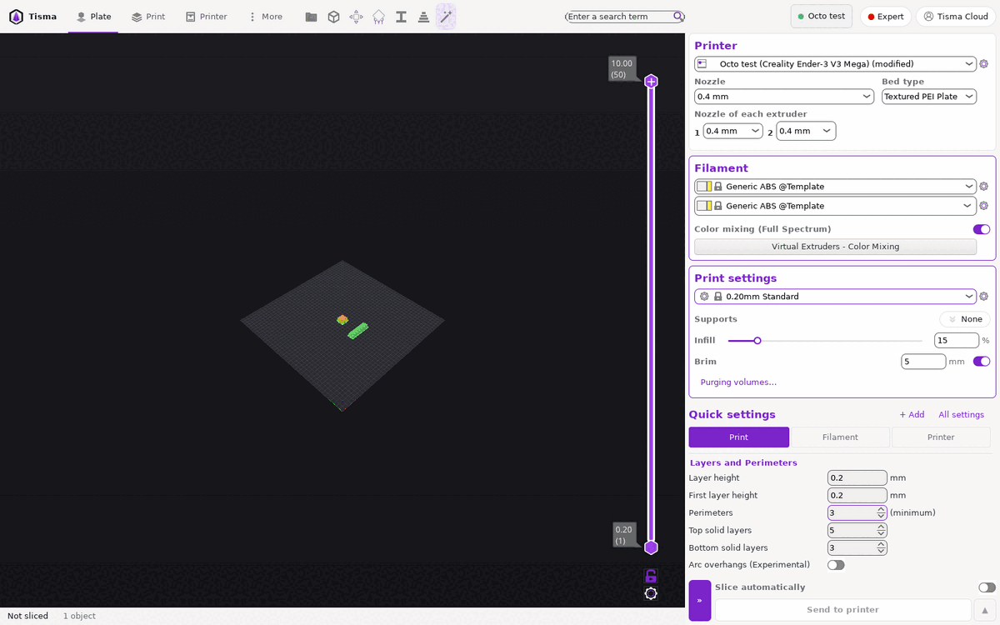

4. **Al cambiar de perfil con cambios sin guardar** se abre un diálogo:
   - título «Preset "<nombre completo>" has the following unsaved changes:»;
   - un árbol por página y grupo, con una casilla por opción y las columnas «Original value», «Modified value» y
     «New value» (el valor del perfil que se va a elegir);
   - botones:
     - «Transfer»: lleva los cambios marcados al perfil nuevo;
     - «Discard»: los pierde;
     - «Save»: guarda y después cambia;
     - «Cancel»: no cambia nada;
   - en un perfil de impresora, «Keep» en lugar de «Transfer»;
   - la casilla «Remember my choice» deja de preguntar.

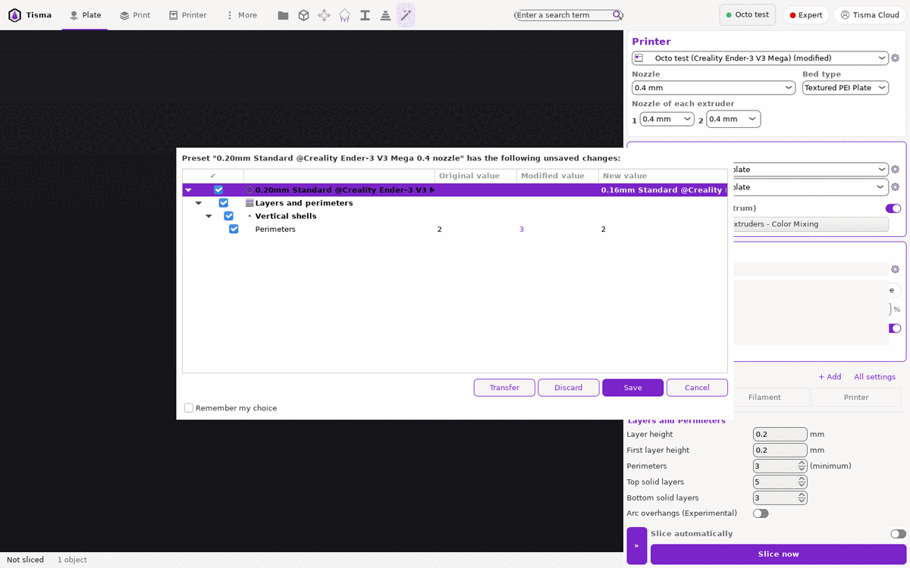

## Guardar, renombrar, borrar

5. **Botones al lado de la lista:** guardar siempre; renombrar (lápiz) y borrar (cruz) solo en perfiles de la
   persona.
6. **Guardar:**
   - un recuadro «Save preset» con el nombre propuesto «<nombre> - Copy», una lista para elegir uno existente,
     «Cancel» y «Save»;
   - una marca verde si el nombre sirve;
   - si es un perfil de la persona que ya existe: «Save preset modifications to existing user profile»;
   - al guardar, el perfil nuevo queda elegido en la lista.
7. **Nombres no permitidos** (el botón «Save» queda apagado y se muestra el motivo):

| Nombre | Mensaje |
|---|---|
| Con alguno de `<>[]:/\|?*"` | «The following characters are not allowed in the name: <>[]:/\|?*"» |
| El de un perfil del sistema | «Cannot overwrite a system profile.» |
| Empieza con espacio | «The name cannot start with space character.» |
| Termina con espacio | «The name cannot end with space character.» |
| Termina con « (modified)» | «The following suffix is not allowed in the name: (modified)» |

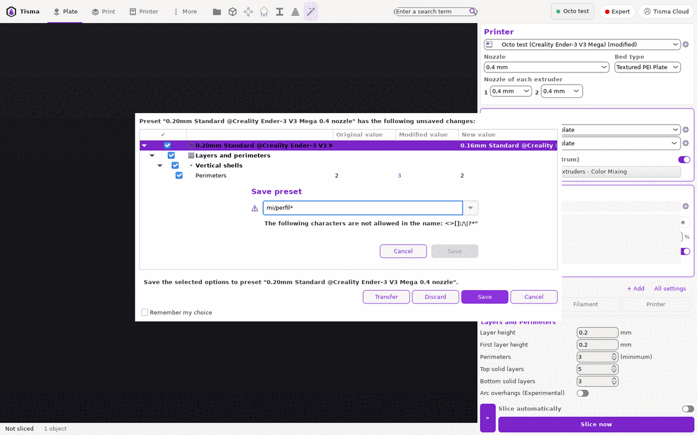

8. **Renombrar:** recuadro «Rename preset» con «Cancel» y «Rename». Cambia el nombre del archivo; el contenido no
   cambia.
9. **Borrar:** pregunta «Are you sure you want to delete the selected preset?» con «No» y «Yes». Con «Yes» se borra
   el archivo y queda elegido el perfil del sistema del que venía.

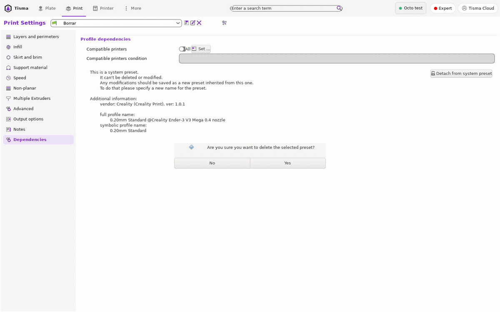

10. **Separar del padre:** «Detach from system preset» en la página «Dependencies». Pregunta «The current custom
    preset will be detached from the parent system preset. This action is not revertible. Do you want to proceed?»
    («No», «Cancel», «Yes»). Después, el padre se muestra como «- default -» y el archivo queda sin padre.

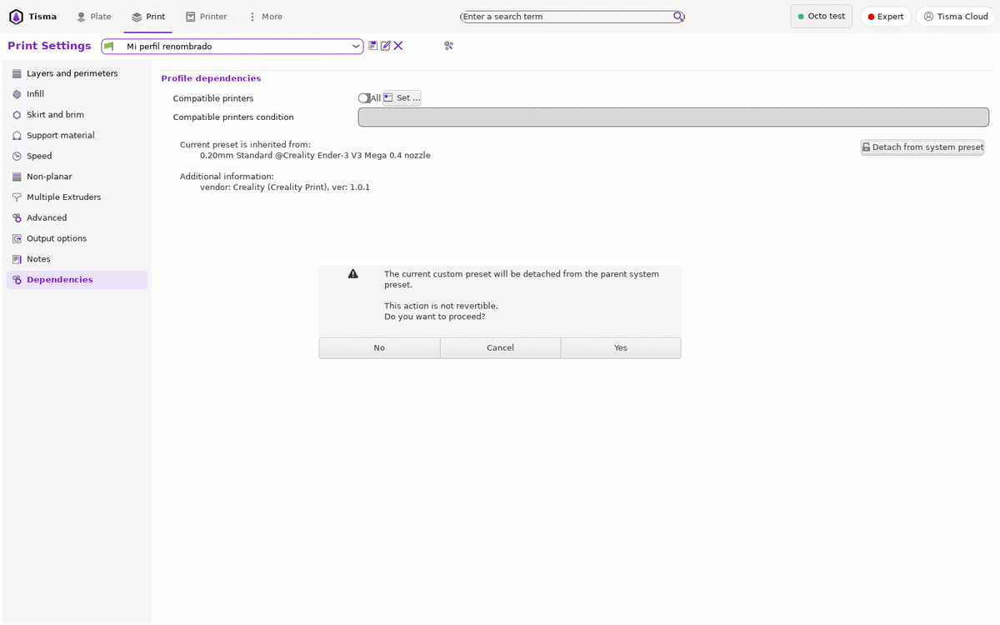

## Compatibilidad

11. **Dónde se pone:** en «Dependencies» de un perfil de impresión o material:
    - «Compatible printers», con un interruptor «All» y un botón «Set…» para elegir impresoras de una lista;
    - «Compatible printers condition», una expresión con los valores de la impresora, por ejemplo
      `nozzle_diameter[0]==0.6`. Solo se puede escribir con «All» prendido.
12. **Efecto:**
    - un perfil que no cumple la condición queda con bandera roja; si estaba elegido, sigue elegido;
    - los perfiles de la persona que no son compatibles no aparecen en la lista;
    - al cambiar la impresora de modo que el perfil elegido deja de ser compatible, se elige solo otro compatible (en
      la medición, el del sistema «0.20mm Standard»).

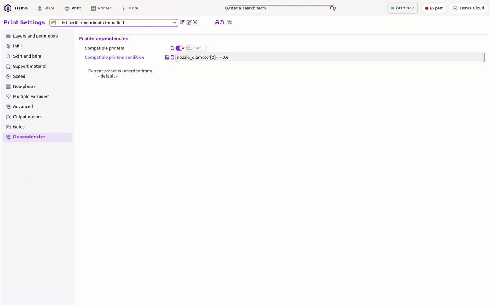

## Comparar

13. **Comparar perfiles:** un botón al lado de la lista («Compare preset with another») y el menú «Window > Compare
    Presets» abren «Select presets to compare»:
    - dos listas de perfiles del mismo tipo, con un signo = o ≠ entre ellas;
    - «Show all presets (including incompatible)»;
    - si son iguales: «Presets are the same»;
    - si no, un árbol por página y grupo con «Left Preset Value» y «Right Preset Value»; el valor de la derecha va en
      color.

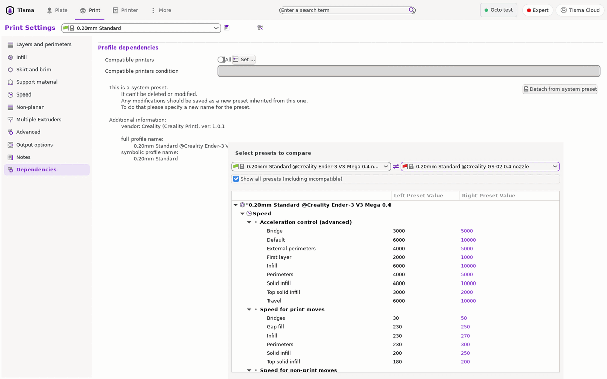

## Paquetes de configuración

14. **Exportar** («Export Config Bundle…»): un archivo de texto con extensión `.ini`:
    - una sección por perfil de la persona, `[print:<nombre>]`, `[filament:<nombre>]`, `[printer:<nombre>]` (y los de
      resina), con todos sus valores;
    - los perfiles del sistema no van;
    - al final, `[presets]` con los perfiles elegidos de cada tipo.
15. **Con impresoras físicas** («Export Config Bundle With Physical Printers…»): además, una sección
    `[physical_printer:<nombre>]` por impresora, y `physical_printer` en `[presets]`. Tisma Slicer escribe ahí las
    claves y contraseñas de acceso **en texto plano**. El motor no las escribe; si la persona las quiere llevar, se
    las pide al importar.
16. **Importar** («Import Config Bundle…»): agrega los perfiles y avisa «<n> presets successfully imported.».
    - un perfil con el mismo nombre que uno existente se reemplaza sin preguntar (cuenta en el número);
    - se eligen los perfiles de `[presets]`.
    El motor pregunta antes de reemplazar.

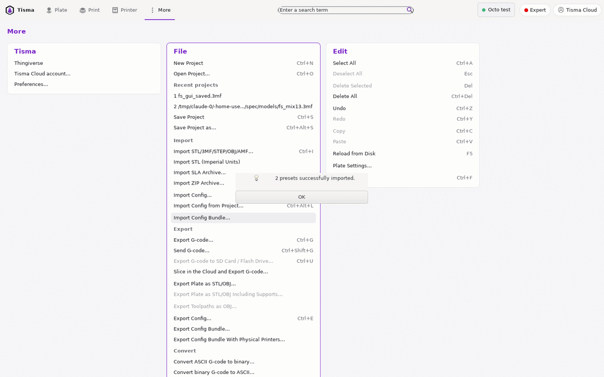

## Instantáneas

17. **Tomar una** («Take Configuration Snapshot»): pide un comentario («Taking a configuration snapshot») y copia en
    una carpeta con fecha y hora (UTC):
    - todos los perfiles de la persona y las impresoras físicas;
    - los perfiles del sistema instalados;
    - un índice con la fecha, la versión del programa, el comentario, el motivo («user» si la tomó la persona) y los
      perfiles elegidos.
18. **Verlas** («Configuration Snapshots…»): una lista; la activa va arriba en verde («Active: <fecha>: User
    (<comentario>)») con la versión, los perfiles elegidos y los perfiles del sistema con su versión.
19. **En el motor:** también se toma una antes de actualizar los perfiles del sistema, y cualquiera de la lista se
    puede volver a activar. No se midió en Tisma Slicer (había una sola instantánea y ninguna actualización).

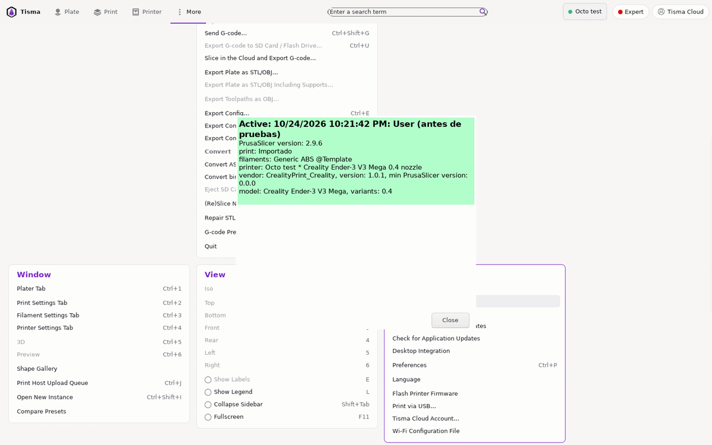

## Parámetros propios para el G-code

20. **Dónde:** en el nivel Expert, al final de la página «Advanced» de impresión, y en las de material e impresora,
    «Custom parameters»:
    un texto JSON de un solo nivel, por ejemplo `{"my_key": "my_value"}`.
21. **Cómo se usan:** cada clave entra a las plantillas de G-code con un prefijo según el perfil:

| Perfil | Clave `mi` se usa como |
|---|---|
| Impresión | `custom_parameter_print_mi` |
| Impresora | `custom_parameter_printer_mi` |
| Material | `custom_parameter_filament_mi[0]` (una por extrusor) |

22. **Valores:** números, textos y verdadero/falso. Un JSON con listas, objetos anidados o mal escrito hace fallar la
    exportación con «Unable to parse custom parameters: print or printer JSON issue». En el motor, el error se muestra
    al escribir el texto, no al exportar.

En el motor son `print.variables`, `machine.variables` y `material.variables`, con los nombres `print_`, `machine_` y
`material_` delante de cada clave.

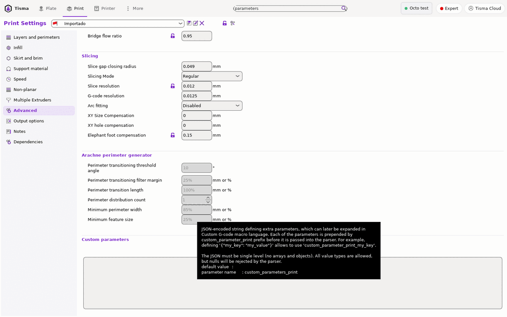

## Pruebas

| # | Escenario | Resultado |
|---|---|---|
| PS1 | Cambiar «Perimeters» en un perfil del sistema | El nombre pasa a «… (modified)»; la opción muestra el candado abierto y la flecha |
| PS2 | Con cambios sin guardar, elegir otro perfil | El diálogo de la regla 4 con las opciones cambiadas marcadas |
| PS3 | Lo mismo en la impresora (boquilla 0,6 a 0,4) y «Discard» | Cambia la impresora; el perfil de impresión que dejó de ser compatible pasa solo a «0.20mm Standard» |
| PS4 | Guardar con un nombre con `/` | «Save» apagado y el mensaje de la regla 7 |
| PS5 | Guardar con el nombre de un perfil del sistema | «Cannot overwrite a system profile.» |
| PS6 | Guardar «Mi perfil» desde «0.20mm Standard» | Aparece en «User presets»; guarda el padre y todos los valores |
| PS7 | Renombrar «Mi perfil» | Cambia el nombre del archivo; el contenido es el mismo |
| PS8 | Separar del padre | Padre «- default -»; el perfil guarda los mismos valores |
| PS9 | Condición `nozzle_diameter[0]==0.6` con boquilla 0,4 | Bandera roja; el perfil de la persona no aparece en la lista hasta elegir 0,6 |
| PS10 | Comparar un perfil consigo mismo y con el de otra impresora | «Presets are the same»; después, un árbol con las diferencias (aceleraciones y velocidades en la medición) |
| PS11 | Borrar un perfil de la persona | Pregunta; con «Yes» desaparece y queda el padre |
| PS12 | Exportar un paquete con un perfil de la persona | Una sección `[print:…]` y `[presets]`; ningún perfil del sistema |
| PS13 | Importar un paquete con un perfil nuevo y uno que ya existe | «2 presets successfully imported.»; el existente se reemplaza |
| PS14 | Tomar una instantánea con comentario | Carpeta con fecha, perfiles e índice; aparece activa en la lista |
| PS15 | Parámetro de impresión `{"mi":5}` y `; VAL={custom_parameter_print_mi}` en el G-code de inicio | `; VAL=5` |
| PS16 | Parámetro de material `{"mi":2.5}` sin índice | Error «Referencing a vector variable when scalar is expected»; con `[0]`, `2.5` |
| PS17 | Parámetro con una lista `{"a":[1]}` | No se exporta el G-code (Tisma Slicer termina igual sin código de error) |
