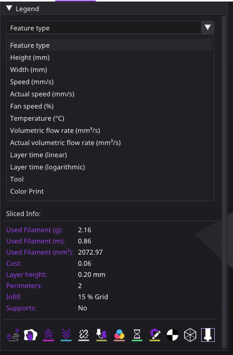
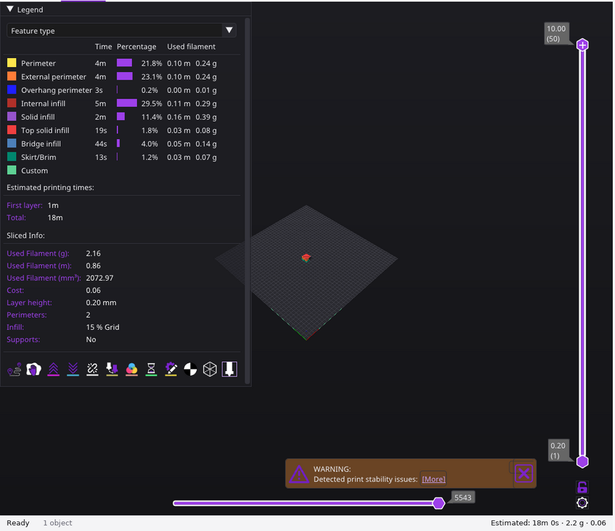
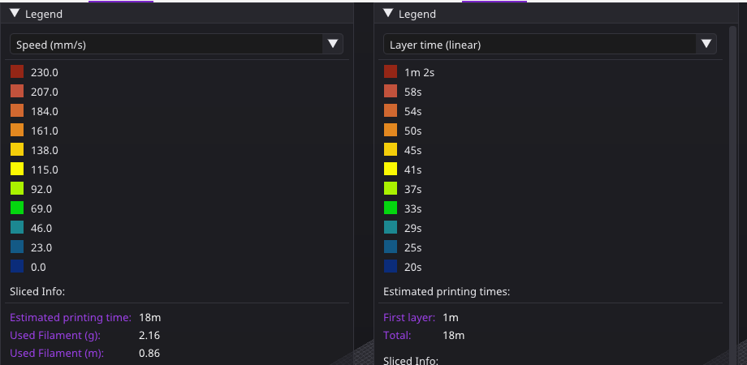
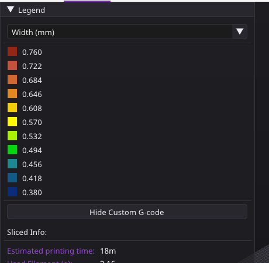

# Vista previa del laminado

**Qué hace:** después de laminar, muestra las trayectorias en 3D con colores según lo que la persona elige (tipo de
línea, velocidad, ancho, tiempo de capa…), una leyenda con tiempos y material, y dos deslizadores para recorrer las
capas y los movimientos. Esta ficha dice lo que muestra Tisma Slicer, medido en su interfaz, y qué toma el motor.

La fila de íconos de la vista previa se nombra en `interface.md`; la revisión antes de imprimir que aparece a la
derecha, en `print_review.md`; el tiempo estimado, en `print_time.md`.

**Fase:** P1, con `interface.md`.

**Fuentes:** la interfaz de Tisma Slicer bajo Xvfb, el 25-10-2026, laminando la pieza en voladizo de las pruebas
(20 × 20 × 10 mm), con 4 capturas en `preview/`.

## Lo que muestra Tisma Slicer

1. **Leyenda** (arriba a la izquierda, se pliega con «Legend»): una lista para elegir qué colorea las trayectorias:

| Vista | Qué colorea |
|---|---|
| Feature type | El tipo de línea (perímetro, perímetro externo, perímetro en voladizo, relleno, relleno sólido, sólido de arriba, puente, falda y borde, G-code propio) |
| Height (mm) | La altura de cada capa |
| Width (mm) | El ancho de cada línea |
| Speed (mm/s) | La velocidad pedida |
| Actual speed (mm/s) | La velocidad que se alcanza con las aceleraciones |
| Fan speed (%) | El ventilador |
| Temperature (°C) | La temperatura de la boquilla |
| Volumetric flow rate (mm³/s) | El caudal pedido |
| Actual volumetric flow rate (mm³/s) | El caudal que se alcanza |
| Layer time (linear) | El tiempo de cada capa, escala lineal |
| Layer time (logarithmic) | El tiempo de cada capa, escala logarítmica |
| Tool | El extrusor |
| Color Print | El color por capa, con los cambios de color |

2. **En «Feature type»,** una fila por tipo con su color, su tiempo, una barra y el porcentaje del tiempo total, y el
   filamento usado en metros y gramos (prueba PV1). Debajo:
   - «Estimated printing times»: la primera capa y el total;
   - «Sliced Info»: filamento en gramos, metros y mm³, costo, altura de capa, perímetros, relleno y soportes.

3. **En las vistas con números** (velocidad, ancho, tiempo de capa…): una escala de 11 colores, de azul (el mínimo) a
   rojo (el máximo), con el valor de cada paso repartido en partes iguales entre el mínimo y el máximo de la pieza
   (pruebas PV2 y PV3). Debajo, el botón «Hide Custom G-code» y los tiempos y datos de la regla 2.

| Velocidad y tiempo de capa | Ancho |
|---|---|
|  |  |

4. **Deslizadores:**
   - vertical, a la derecha: dos tiradores para la capa de arriba y la de abajo que se ven, con la altura y el número
     de capa («10.00 (50)», «0.20 (1)»);
   - horizontal, abajo: el último movimiento que se dibuja dentro de la capa de arriba, con su número (5543 en la
     prueba PV1);
   - un candado y un engranaje debajo del deslizador vertical.
5. **Fila de íconos** debajo de la leyenda: 12 botones para mostrar u ocultar elementos. `interface.md` nombra viajes,
   barridos, retracciones, costuras, cambios de herramienta y de color, pausas, centro de gravedad y la pieza. Bajo
   Xvfb no aparecieron sus textos de ayuda; qué hace cada ícono no se midió.

## Lo que hace el motor

6. **Las mismas vistas,** calculadas del G-code que el motor escribe: cada movimiento lleva su tipo, ancho, altura,
   velocidad pedida y alcanzada, ventilador, temperatura, caudal, herramienta y tiempo. La vista por tiempo de capa
   usa el tiempo de `print_time.md`.
7. **Escala:** 11 pasos iguales entre el mínimo y el máximo, como en la regla 3; en la vista logarítmica, iguales en
   logaritmo. Con un solo valor, un solo color.
8. **Porcentajes:** del tiempo total, como en la regla 2, más el filamento por tipo en metros y gramos.
9. **Deslizadores:** los mismos dos, con altura y número de capa, y el número de movimiento.

## Pruebas

Medidas en Tisma Slicer (25-10-2026) con la pieza en voladizo (`cantilever.stl`, 20 × 20 × 10 mm) y el perfil «0.20mm
Standard» de la impresora de prueba (relleno `grid` al 15 %, borde de 5 mm).

| # | Vista | Resultado en Tisma Slicer |
|---|---|---|
| PV1 | Feature type | Perímetro 4 min, 21,8 %; perímetro externo 4 min, 23,1 %; perímetro en voladizo 3 s, 0,2 %; relleno 5 min, 29,5 %; relleno sólido 2 min, 11,4 %; sólido de arriba 19 s, 1,8 %; puente 44 s, 4,0 %; falda y borde 13 s, 1,2 %. Primera capa 1 min, total 18 min; 2,16 g, 0,86 m, 2072,97 mm³. 50 capas, 5543 movimientos en la última |
| PV2 | Speed (mm/s) | De 0,0 a 230,0 en pasos de 23,0 |
| PV3 | Width (mm) y Layer time (linear) | Ancho de 0,380 a 0,760 en pasos de 0,038; tiempo de capa de 20 s a 1 min 2 s |
| PV4 | La lista de vistas | Las 13 de la regla 1 |
