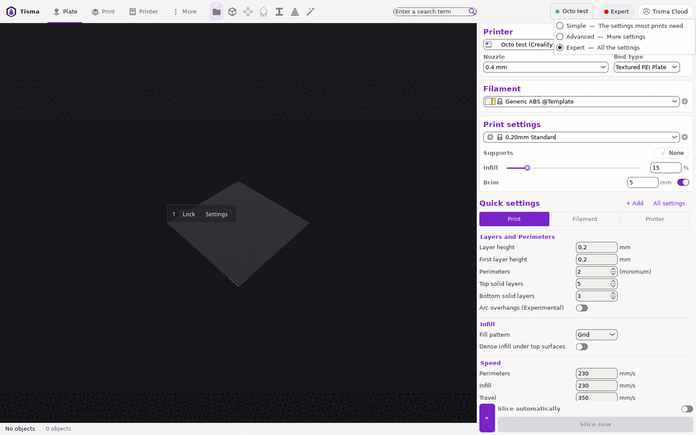
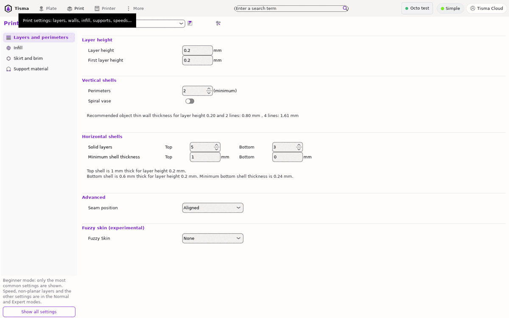
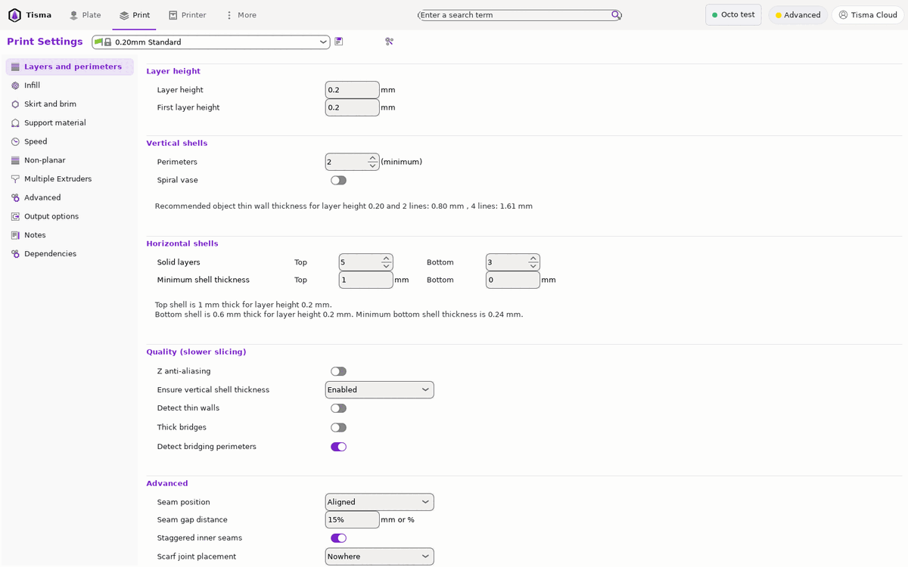
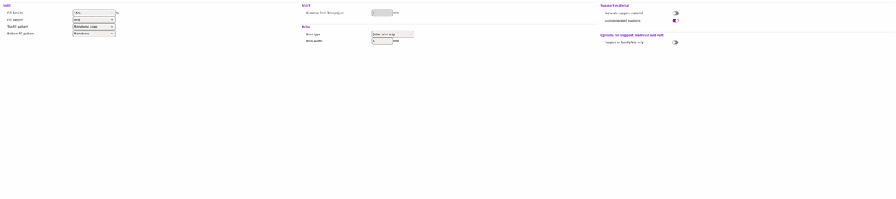
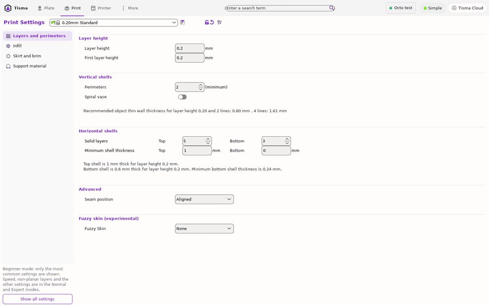
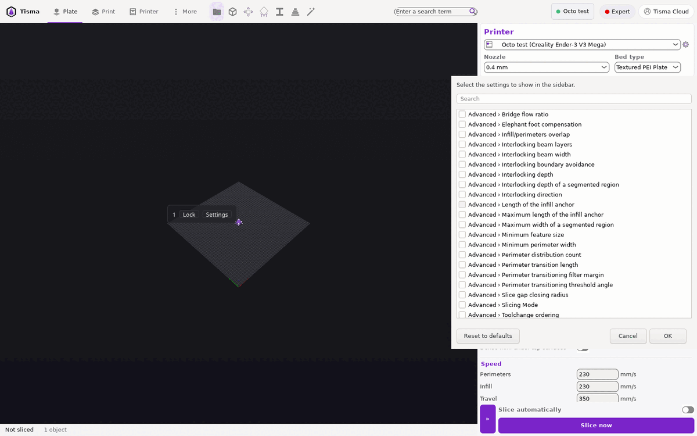
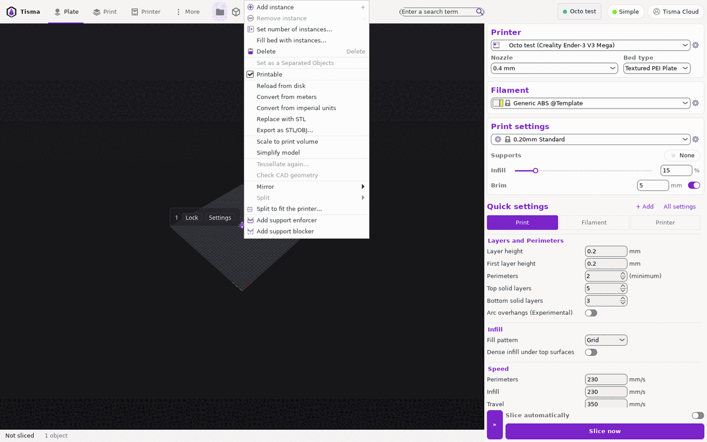
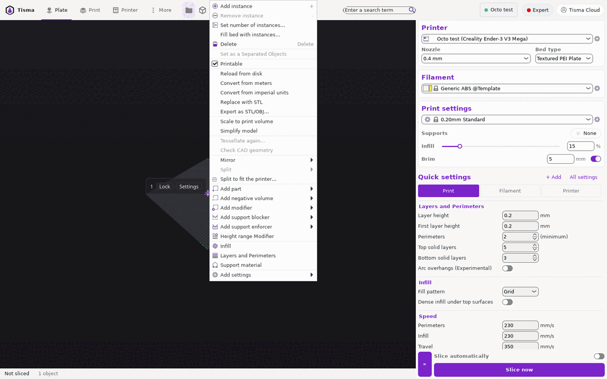
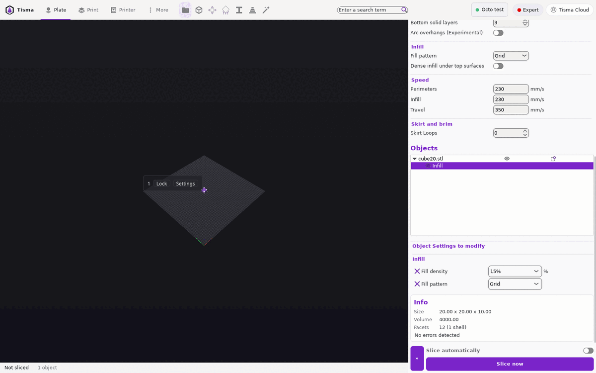

# Niveles de ajustes y ajustes por objeto

**Qué hace:** muestra más o menos ajustes según el nivel que elige la persona, deja armar una lista propia de ajustes a
mano y permite que una pieza tenga sus propios valores. El dueño quiere para el motor:
- niveles simple, medio y avanzado;
- un nivel propio, donde la persona agrega y quita los ajustes visibles;
- tres secciones grandes (impresora, material, objetos) en el mismo panel de la izquierda.

Esta ficha dice cómo lo hace Tisma Slicer, medido en su interfaz, y qué toma el motor.

**Fase:** P1, con `interface.md`.

**Fuentes:** la interfaz de Tisma Slicer bajo Xvfb, el 25-10-2026, con 9 capturas en `settings_levels/`.

## Niveles en Tisma Slicer

1. **Tres niveles,** elegidos en el chip de la barra superior (`interface.md`):
   - «Simple — The settings most prints need» (punto verde);
   - «Advanced — More settings» (punto amarillo);
   - «Expert — All the settings» (punto rojo).
   Cada ajuste tiene un nivel fijo; en un nivel se ven los suyos y los de los niveles de abajo.

2. **Páginas por nivel:**

| Sección | Simple | Advanced y Expert |
|---|---|---|
| Impresión | Layers and perimeters, Infill, Skirt and brim, Support material | Las anteriores más Speed, Non-planar, Multiple Extruders, Advanced, Output options, Notes, Dependencies |
| Impresora | General (vacía), Extruder 1, Dependencies | General, Machine limits, Extruder 1, Notes, Dependencies |

3. **Ajustes de impresión en Simple:**
   - **Layers and perimeters:** altura de capa y de la primera capa; perímetros; modo espiral; capas sólidas de arriba
     y de abajo; espesor mínimo de la cáscara arriba y abajo; posición de la costura; piel difusa;
   - **Infill:** densidad, patrón, patrón de arriba y patrón de abajo;
   - **Skirt and brim:** distancia de la falda al borde o a la pieza (apagada sin falda), tipo y ancho del borde;
   - **Support material:** generar soporte, soporte automático, solo desde la cama.
4. **Ajustes de la impresora en Simple:** la página General queda vacía; Extruder 1 muestra el diámetro de la
   boquilla, el color del extrusor, el salto en Z y el largo de la retracción.
5. **Advanced suma** en las mismas páginas, por ejemplo en Layers and perimeters:
   - el grupo «Quality (slower slicing)»: Z anti-aliasing, asegurar el espesor vertical, detectar paredes finas,
     puentes gruesos, detectar perímetros en puente;
   - en «Advanced»: separación de la costura, costuras internas alternadas y la ubicación de la unión en bisel.
   La lista completa por ajuste entre Advanced y Expert no se midió (hace falta recorrer todas las páginas en los
   dos niveles).
6. **Aviso del nivel Simple:** abajo de la lista de páginas: «Beginner mode: only the most common settings are shown.
   Speed, non-planar layers and the other settings are in the Normal and Expert modes.» y el botón «Show all settings».
   El aviso dice «Normal» donde el menú dice «Advanced»: el motor usa un solo nombre por nivel.

| Simple | Advanced |
|---|---|
|  |  |

7. **Un ajuste cambiado en un nivel más alto:**
   - al bajar de nivel desaparece de la página, sin marca en la fila;
   - el valor queda en el perfil (no se midió el G-code);
   - la única señal son los íconos de cambios arriba de la página (candado abierto y flecha atrás, `presets.md`,
     regla 3).
   El motor muestra el ajuste cambiado también en los niveles más bajos, marcado, o un aviso con la cantidad de
   cambios ocultos y un botón para verlos.

## Lista propia de ajustes (Quick settings)

8. **En el panel de la placa,** debajo de los perfiles, «Quick settings» muestra una lista corta de ajustes con tres
   pestañas (Print, Filament, Printer). La lista de fábrica, en la pestaña Print:
   - Layers and Perimeters: altura de capa, de la primera capa, perímetros, capas sólidas de arriba y de abajo, Arc
     overhangs;
   - Infill: patrón, relleno denso bajo las superficies de arriba;
   - Speed: perímetros, relleno, viaje;
   - Skirt and brim: vueltas de la falda.
9. **«+ Add»** abre «Select the settings to show in the sidebar.»:
   - un buscador;
   - todos los ajustes como «Página › Ajuste», cada uno con una casilla;
   - «Reset to defaults», «Cancel» y «OK».
   Es lo más cercano al nivel propio que pide el dueño: la persona elige qué ajustes ve.

## Ajustes por objeto

10. **Agregarlos:** clic derecho sobre la pieza. En Simple, el menú no ofrece partes, modificadores ni ajustes. En
    Advanced y Expert agrega:
    - Add part, Add negative volume, Add modifier, Add support blocker, Add support enforcer, Height range Modifier;
    - accesos directos «Infill», «Layers and Perimeters», «Support material»;
    - «Add settings ▸» con el resto de las páginas.

| Simple | Expert |
|---|---|
|  |  |

11. **En la lista de objetos** (panel de la placa, sección «Objects»):
    - la pieza tiene una fila hija con el nombre del grupo («Infill») y su ícono;
    - al elegirla, abajo aparece «Object Settings to modify» con el grupo y sus ajustes («Fill density» 15 %, «Fill
      pattern» Grid), cada uno con una cruz para quitarlo de la pieza;
    - los valores parten de los del perfil.

## Lo que hace el motor

12. **Niveles:** simple, medio, avanzado y propio.
    - Cada ajuste del motor (`SETTINGS_V1.md`) lleva su nivel; simple y medio salen de las tablas de esta ficha.
    - El propio parte de un nivel y la persona marca o desmarca ajustes, como el diálogo de la regla 9, pero para todo
      el panel y no solo para la lista corta.
13. **Tres secciones** en el panel de la izquierda: Impresora, Material y Objetos. La de Objetos lista las piezas y,
    debajo de cada una, sus ajustes propios, partes y modificadores (regla 11).
14. **Nada oculto sin aviso:** regla 7.

## Pruebas

| # | Escenario | Resultado en Tisma Slicer |
|---|---|---|
| NV1 | Nivel Simple, página de impresión | 4 páginas, con los ajustes de la regla 3, y el aviso de la regla 6 |
| NV2 | Nivel Advanced, página de impresión | 11 páginas; Layers and perimeters con el grupo «Quality (slower slicing)» |
| NV3 | Nivel Simple, página de la impresora | General vacía; Extruder 1 con 4 ajustes |
| NV4 | Cambiar «Seam gap distance» a 20 % en Advanced y volver a Simple | El ajuste no se ve; arriba de la página, candado abierto y flecha atrás |
| NV5 | Clic derecho sobre un cubo en Simple y en Expert | Simple: sin «Add part», «Add modifier» ni «Add settings». Expert: con todos, más «Infill», «Layers and Perimeters», «Support material» |
| NV6 | Expert, «Infill» en el menú de la pieza | En Objects, la fila hija «Infill»; abajo, «Fill density» y «Fill pattern» con su cruz |
| NV7 | «+ Add» en Quick settings | El diálogo de la regla 9 con todos los ajustes como «Página › Ajuste» |
